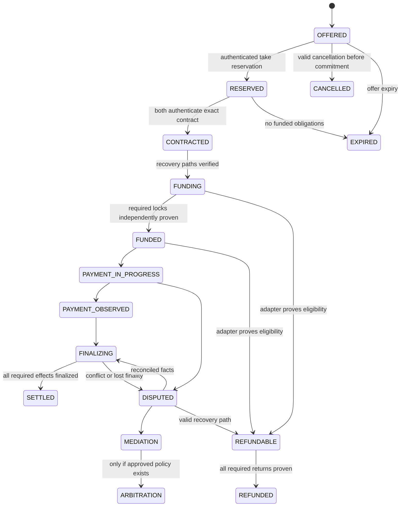

# Build 8 general decentralized trading system - canonical specification V1, revision 17

Status: APPROVED DESIGN BASIS / CANDIDATE IMPLEMENTATION. T2 FINAL CANONICAL LOCK PENDING. Genesis UNSEALED. Date: 2026-10-02.

This is the single maintained trading specification. The latest TRADING ARCHITECT DECISION LOCK, received sections 1-25, controls conflicts; the prior 65-section master controls remaining scope. Original Architect messages are controlling. This reconciliation is not a verbatim transcript and infers no unseen sections. The previous report snapshot is archived under qualification/trading-predecision-20261001, preserving its delivered hash and historical evidence.

ARCHITECT LOCK identifies supplied decisions; FORGE ENGINEERING DECISION identifies reversible sequencing; CODEX IMPLEMENTATION DETAIL identifies candidate code; UNRESOLVED identifies only genuinely unspecified final semantics or policy. Evidence labels remain separate. No offline pass authorizes production.

**Latest Architect launch scope:** all required protocol features must be built before launch; only Desktop App, Mobile App and Miner Firmware may be upgraded afterward. Wallet-only Desktop 1.0 limits the client surface, not protocol scope. Required trading, state, proof and settlement capabilities cannot be deferred to a post-Genesis protocol upgrade. Earlier future-rail deferrals do not waive this requirement. Mainnet readiness target is 2026-10-03 18:54 UTC (48 hours from the relayed 2026-10-01 priority change); it is a target, not permission to weaken security, omit scope, activate fiat rails, use production keys/funds or seal Genesis. Existing approvals still govern final activation.

## 1. Historical baseline and T1 closure

**ARCHITECT LOCK:** T1 = CLOSED / HISTORICAL EVIDENCE BOUNDARY ACCEPTED. The old Synthetic Exchange source was intentionally removed with the prior generation and will not be imported merely to satisfy a historical gate. Historical reports remain provenance only. No fresh inspection or reproduction of the discarded source is claimed. Build8 continues from this canonical design.

The earlier read-only audit and failed checkpoint lookup remain [dated provenance](BUILD8-TRADING-BASELINE-AUDIT-V1.md). Current wallet/transport/state components and the three isolated trading research slices are reusable only to their documented evidence level. Synthetic settlement assertions must never become financial facts.

| Classification | Current disposition |
|---|---|
| EXISTING | Current wallet/state/transport code; dated 30-test journal, 36-test discovery, 40-test durable-maker and 34-test Treasury research snapshots |
| REUSABLE | Qualified context binding, exact review, current wallet authority, sparse proofs, bounded queues and operation persistence patterns |
| MUST REPLACE | Mock authentication/funding evidence before any real-value integration; old Treasury caps/pricing defaults as active policy |
| MISSING | Public discovery, full negotiation, production Bitcoin/SPV and live adapter qualification, full settlement/history/UI; authenticated session-to-durable execution now qualified offline |
| DEFERRED | Client application delivery only where permitted; optional trade reputation remains separate. Required protocol features are prelaunch; no fiat or required future-rail protocol implementation is deferred by client scope |
| REQUIRES ARCHITECT | One final exact D1 lock before canonical Mainnet/Genesis; only actual unsupplied fiat policy/authority seams or newly discovered beneficiary change |
| READY TO IMPLEMENT | Approved D1 candidate primitives, fiat normal profile, neutral adapters, codecs, faults and integration behind non-production gates |

## 2. Approved design basis and engineering authority

**ARCHITECT LOCK:** The delivered General Trading Architecture and Decision Report is approved as the Build8 design basis subject to the latest sections 1-25 decision lock. The prior 65-section directive remains controlling where not superseded. This document is the single active specification, not a new competing packet.

One peer-to-peer, non-custodial, decentralized, modular engine serves ordinary BTC/MUT, License resale, Treasury conversion, fiat and future rails. There is no central matching server, authoritative exchange order database, omnibus wallet, universal spending key or cloud requirement. Public discovery, chat and negotiation remain outside consensus. Trade identity is separate from every spending/node/Worker/Continuity/relay/release/Treasury role.

Minimum consensus additions are approved for candidate engineering: conditional MUT lock/claim/refund; atomic native License/MUT DvP; a consumable single-fill anchor; Treasury destination state/rotation. Candidate implementation, integration under non-production gates, vectors, fuzzing and offline qualification proceed now. They are not final Mainnet schemas, registry allocations, ProtocolFingerprint commitments or Genesis activation.

Proposed module boundaries remain trade-types, untrusted discovery caches, negotiation, rail-neutral lifecycle, settlement adapters, private transport, history, proof verification and external signers. Dependencies point from trading toward native services. Native consensus/mining/MUT/Continuity/LoRa continue independently of Bitcoin, banks, Internet, cloud and price feeds. Existing funded trades retain recovery obligations during outage.

## 3. Canonical object inventory, identities and codec proposal

**ARCHITECT LOCK:** signed objects bind NetworkID, GenesisID, ProtocolFingerprint, protocol version, object type/domain and the relevant parties/contracts. Wrong context, unknown mandatory versions or invalid signatures reject. Trade identity is independent of wallet, Node, Worker, Continuity, relay, release and both Treasury identities. It conveys no spend authority, voting weight or TPM status.

**CANDIDATE / FINAL MAINNET SEMANTICS NOT LOCKED engineering schema:** strict definite-length CBOR arrays with fixed field order, shortest integers, exact hash/key sizes, bounded byte strings/collections, exact re-encoding and no trailing data. Amounts use asset-qualified integer units; prices use reduced positive integer ratios and explicit rounding/net-fee semantics. No floats, locale strings, ambiguous asset ticker or arbitrary executable adapter data. Fixed-price and market-relative are tagged alternatives; unresolved pricing models reject. Identity/signature encoding must follow the qualified Build 8 suite, with separate trade role/domain registration reviewed before allocation. Reuse the existing SHA-256 domain-plus-NUL convention for 32-byte object commitments; do not claim a stronger collision margin or change wallet signing preimages.

| Object | Required binding / semantics | Visibility / authority |
|---|---|---|
| TradeOfferV1 | Context; maker trade descriptor/generation; maker nonce; asset IDs and chain IDs; buy/sell; min/max/exact quantities; fixed/rational or fully described market-price policy; adapter/version; payment-method code; deposits; expiry; finality policy; unique-fill commitment; signed terms | Public subset; maker trade authentication only |
| TradeCancelV1 / TradeReservationV1 | OfferID, maker sequence, taker when applicable, reservation expiry, complete context, contract commitment when known | Signed public revocation / private take response; no consensus finality |
| TradeIntentV1 | OfferID, distinct maker/taker descriptors, fresh taker nonce, selected exact terms, contract draft hash | Private negotiation; cannot move value |
| TradeContractV1 | TradeID/OfferID, both parties, all assets/amounts/prices/fees, deposits, adapters, payment method, exact recipients, deadlines with clock domains, refund/dispute/finality policies, complete Treasury freeze if applicable | Both parties authenticate identical canonical bytes before funding |
| TradeSessionV1 / TradeMessageV1 | Context, OfferID, TradeID, both identities/generations, contract hash, session/transcript identity, sender role, message kind, sequence, expiry, predecessor/ack semantics | Private AEAD data and bounded delivery metadata |
| TradeFundingV1 | Contract/leg/operation ID, artifact bytes/hash, expected output or License lock, chain ID, transaction identity and selected proof kind | Private by default; chain facts verified by adapter |
| TradeSettlementEvidenceV1 | Contract, leg, adapter/version, evidence type, exact effect, authentic anchor and observation revision | Wrapper around existing MUT SettlementProof; does not redefine that consensus object |
| TradeConfirmationV1 | Evidence digest, anchor, confirmation policy, depth/finality result, observer verification provenance | Observation; can be superseded by reorg evidence without erasing history |
| TradeRefundV1 | Contract/leg, funding outpoint/License lock, exact return destination, eligibility and fee bounds, operation ID, signed artifact / proof | Explicit recovery effect, never a reset |
| TradeDisputeV1 | Contract, reason enum, requested remedy, minimal evidence references, roles, consent, deadlines and result authority | Private access-controlled record; no signature/spend power implied |
| TradeReceiptV1 | Contract hash, each leg's exact value/destination/TXID/proof, fees, License result if any, terminal outcome and settlement anchors | Encrypted full record; explicit redacted export |
| MutTreasuryDestinationV1 | TreasuryID, generation, AddressID, effective epoch, WalletCryptoSuiteID/descriptor generation and authorized transition proof | Canonical public state, details require consensus/authority lock |
| TreasurySwapIntentV1 / TreasuryConversionReceiptV1 | Section 12 constraints plus complete unsigned BTC effects and exact net MUT expectation | Public/auditable subset, never secrets |

Candidate domain names are `MUTINY-BUILD8-TRADE-{OFFER,ID,CONTRACT,CANCEL,RESERVATION,MESSAGE,OPERATION,RECEIPT}-V1`; Treasury names remain distinct. These are proposals in this document only, not reserved production identifiers. Adapter evidence has its own type/version and cannot be accepted under a generic untyped proof field.

OfferID is proposed as the domain hash of canonical unsigned offer body excluding its own ID and signature. Signature randomness does not create another offer. The signed envelope commits that body/ID. TradeID is proposed from full context, OfferID, maker/taker IDs and both nonces, excluding its own ID, signatures and downstream contract hash to avoid a cycle. Contract hash commits the resulting TradeID and every agreed term. OperationID commits context, TradeID, contract hash, leg, action and authorized generation; reattempting an operation never changes its identity. Replacement generations need explicit adapter authorization, not merely a new counter.

T3 must publish exact schema tables, error taxonomy, byte/hash/signature vectors from independent implementations, numeric limits and hostile decoding tests before a codec is called qualified. Resource limits are engineering limits, not silently adopted trade economics. No final codec is locked by a research JSON encoder.

Candidate inventory now additionally includes ConditionalMutOutputV1, Lock/Claim/Refund, LicenseMutDvpV1, SingleFillConsumptionV1, MutTreasuryDestinationRotateV1 and FiatMutLock/DualApprovalRelease. Exact executable schemas and candidate-only numeric tags are in [the current V2 candidate supplement](BUILD8-TRADING-D1-CANDIDATE-V2.md). No candidate tag is inserted into the production registry.

## 4. General state machine and adapter semantics

**ARCHITECT LOCK / proposed refinements.** Store offer state, contract state, each leg's state and each money-moving operation separately. A single COMPLETE flag cannot describe all of them. A funded trade cannot become CANCELLED, EXPIRED or FAILED merely through a UI timeout.



The diagram is a high-level projection, not permission for every adapter to use every edge. Adapter lifecycle PREPARE, FUNDED, PAYMENT_OBSERVED, FINALIZING, SETTLED, REFUNDABLE, REFUNDED, DISPUTED and FAILED_TYPED_REASON is derived from validated facts. Funding order is protocol-specific. PARTIAL/PENDING evidence and per-leg conflicts remain visible. Typed transient errors retain the last proven state; terminal failure requires proof that no live lock, payment or refund obligation was lost. Post-settlement reorg records a new settlement-uncertainty revision and freezes new effects; it does not delete the prior receipt or create a new TradeID.

## 5. Decentralized discovery, cancellation and single-fill limits

**FORGE ENGINEERING DECISION / proposed design.** Independently operated peers gossip compact offer inventories; receivers request selected objects. Local indexes validate version/context/size/expiry before expensive signature work, then verify maker trade authentication. No relay result is authoritative. Manual peer provisioning and cached peers remain possible; optional bootstrap lists supply reachability only, never admission authority. Inventory, body, signature-work and per-peer quotas have separate budgets, bounded TTLs and bounded eviction. A trade identity is cheap to replace: per-identity limits alone do not resist Sybils. Combine connection/traffic budgets, fair scheduling, duplicate suppression and measured admission costs; paid deposits/resource fees require Architect economics.

Maker disconnect makes an offer unavailable for safe new negotiation, not an automatic proof of cancellation. Signed cancellations and terminal tombstones outlive the offer's replay horizon; expiry stays in the signed body. Reconnection retrieves bounded deltas and tombstones. Expired objects cannot obtain a fresh lifetime from relay receipt time. An amended offer is a new signed offer with explicit supersession, not mutation of accepted terms. Local persistence serializes cancel/take and concurrent takers; a durable reservation is committed before an acceptance reply. Retrying the same take returns the same reservation. A funded obligation cannot be cancelled by replaying a public cancellation.

**APPROVED DIRECTION / integration guarantee still to qualify.** Honest-maker local reservations prevent accidental double takes but cannot stop a malicious maker signing two acceptances across partitions or restored journals. Gossip, signatures, reputation and deterministic IDs do not establish global exclusion. The recommended settlement proposal binds each single-fill offer to one canonical consumable reservation/funding anchor and exactly one taker/contract; a taker verifies its final consumption before risking an irreversible leg. Same anchor double spends are resolved by the relevant ledger, not by a matching service. The new MUT OfferConsumption/conditional-lock primitive is approved for D1 candidate engineering; exact final semantics await the consolidated final lock. Its scope must be limited to value-safety, not an on-chain order book. Until a reviewed construction supplies that guarantee, the single-fill release criterion and real-value offer taking remain blocked. Claims of globally unique successful fills must be tested with equivocating makers, not only a mutex.

**Decision-lock correction:** minimal canonical one-time value consumption is approved for candidate implementation. It must be consumed atomically with first canonical funding; reservations alone still cannot prevent equivocation. The isolated candidate keys consumption by full context and OfferID, excluding changing taker/contract/generation fields. It retains tombstones after claim/refund. V2 verifies a hybrid-signed, deterministically identified economic offer and maker consent to the exact operation before consumption; current wallet approvals remain additionally required. Unrelated wallets or trade identities cannot squat a known OfferID. Its global proof depends on one canonically finalized ledger; public discovery, persistent canonical storage and final provider/domain integration remain to qualify.

## 6. Private messaging, privacy transport and threat model

**ARCHITECT LOCK.** Public offers disclose only discovery-critical facts. Payment account details, addresses where not publicly required, chat, negotiated contract, recovery secrets and disputes are private. No wallet spending key enters a relay. Trade identity and session keys are independent of every monetary/system identity.

**PROPOSED engineering path:** adapt the already approved Build 8 X448 + ML-KEM-1024, HKDF-SHA512, ChaCha20-Poly1305 transport profile with trade-specific endpoint identities, roles and transcript domains. Preserve required hybrid authentication; do not invent an Ed448/FN-DSA adaptor protocol. `spec/HYBRID-TRANSPORT-SESSION-V2.md` is component evidence, not ready-made trade onboarding or anonymity. Pin the maker to its verified offer descriptor, the taker to the accepted reservation, and both to the dual-authenticated contract. A peer-provided key alone is not authority. Negotiation transcript and final key confirmation bind OfferID, TradeID, full context, identities, versions and final contract hash. A contract change forces fresh authentication; no unsigned UI strings determine settlement.

Messages carry sender role, monotonic sequence, typed purpose, bounded length, expiry and causal reference. Reject wrong-session/trade/network, downgrade, truncation and duplicate side effects. Bounded reorder windows and acknowledgements reconcile delivery; an ACK proves delivery only. Fresh transport handshakes on restart avoid nonce reuse. Durable message IDs are distinct from per-session AEAD sequences. Store-forward envelopes contain ciphertext for an already established authenticated session or reviewed recipient encryption scheme; no first-contact offline encryption construction is silently invented. Persist nonce allocation before ciphertext release, or abandon that traffic key and start a fresh session. Mailbox quotas and TTL bound compliant local storage; encryption and retrieval authorization limit disclosure. A malicious relay can retain ciphertext and metadata beyond TTL. Crash/replay tests must cover these obligations before enabling offline messaging.

Tor onion-service transport is the recommended first privacy carrier; direct encrypted mode is explicit informed opt-in with conspicuous weaker-privacy status. No automatic clear-net fallback after Tor failure. Tor is a mature privacy transport, not a promise against global correlation or compromised endpoints. Other anonymity carriers require evidence; no custom anonymity cryptography. [Tor v3 specification](https://spec.torproject.org/rend-spec/index.html). Bisq's peer network, Tor use and private trade communication are engineering references only. [Bisq introduction](https://bisq.wiki/Introduction).

| Actor | Learns / can do | Required protection / residual limit |
|---|---|---|
| Maker / taker | Public offers, own private contract and necessary counterparty payment data; can lie, vanish, equivocate or publish chats | Exact contract and chain validation, safe recovery; counterparties can retain disclosed data |
| Offer relay / network peer | Public offer content, timing, inventory requests and route metadata; can censor/reorder/spam | End-to-end signatures, bounded queues, multiple routes; no guaranteed global completeness |
| Full node / Mutiny observer | Canonical transactions, ownership changes, amounts and public Treasury destination | Keep chats/payment data off-chain; no claim that public ledger transfers are anonymous |
| Bitcoin observer | On-chain scripts, amounts, graph, hash/preimage linkage where used | Minimize gratuitous identifiers; conditional swaps can be correlated across chains |
| Mediator / arbitrator | Only deliberately disclosed evidence; can misadvise or leak it | No private keys or implicit payout authority; minimize evidence and authenticate policy |
| Network observer / malicious relay | Timing, sizes and endpoints visible on direct/RF links; can delay or partition | Onion routing where available, padding only after measurement; global traffic analysis remains a risk |
| Compromised UI / coordinator | Can display false terms, request malicious signatures, leak local data | Independent signer reconstructs exact effects from authenticated contract/state; compromise still harms availability/privacy |

Fiat inherently reveals selected account information and can expose civil identity. LoRa exposes local radio presence and traffic patterns; encryption is not anonymity. Public-safe exports must use a whitelist and cannot simply hash low-entropy bank data and call it private. No trade reputation feeds Continuity reputation, voting, bonds or TPM authority.

## 7. Ordinary BTC/MUT settlement and actual MUT capability matrix

**ARCHITECT LOCK:** users retain keys; temporary locking only under an explicitly reviewed non-custodial construction. The exchange cannot call sequential payments atomic. The following inspected current-code capabilities constrain feasibility; exact source hashes are retained in the source-window manifest and `BTC-MUT-MARKET-CAPABILITY-MATRIX-V1.md`.

| Capability | Actual source evidence | Reuse / missing behavior |
|---|---|---|
| MUT outputs | `consensus/src/transactions.rs:37`, `state_records.rs:17` | Owner+amount and creation metadata; no executable hashlock/refund branch |
| Transaction dispatch | `hybrid_transaction_v2.rs:14`, `execution_v2.rs:146` | Transfer/Rotate and separately supported lifecycle operations; no general swap lock/claim/refund |
| Hybrid owner authorization | `transactions_v2.rs:263`, `crypto-v2/src/lib.rs:201` | BOTH Ed448 and FN-DSA required; keep that on every required MUT authorization |
| Exact output/identity binding | `transactions_v2.rs:42`, `:128`, `:133` | Unsigned-body identity and complete output signatures; no covenant over a later spend |
| Inclusion expiry | `transactions_v2.rs:244` | Earliest/latest inclusion only; expiry is not refund or exclusive escrow |
| Bounds / execution | `transactions.rs:7`, `hybrid_transaction_v2.rs:164`, `execution.rs:644` | Native conservation, full signed-byte fees, 16 KiB bound, tentative-state atomicity; new witnesses must fit |
| Wallet rotation | `wallet_authority_v1.rs:105`, `:134`, `wallet_rotation_v1.rs:186` | Old addresses resolve through current authority; not a Treasury registry or appointment |
| Payment evidence | `settlement.rs:145`, `:232` | Anchored exact MUT output/amount and UTXO evidence; not BTC evidence or arbitrary spent historical receipt |
| License state | `license_assignment_v2.rs`, `license_book_v2.rs`, `spec/LICENSE-ASSIGNMENT-STATE-V2.md` | Owner-authorized Worker assignment exists; assignment does not transfer License ownership |

**PROPOSED preferred path (D1):** specify minimal MUT conditional settlement rather than copy a BTC-only escrow. Let A sell BTC for MUT, B sell MUT for BTC. Contract binds a fresh shared hash condition, exact success/refund destinations, values, clocks and fees. A funds a Bitcoin-native output claimable by B with the preimage and required Bitcoin authorization, with A's later refund branch. B validates funding/finality and safe remaining time, then funds a proposed MUT condition with earlier refund eligibility and exact success output to A. A verifies the MUT condition and safely claims MUT, disclosing the preimage; B uses it to claim BTC. Each funded output has mutually exclusive actual spends, not two independent transfer promises.

```text
F_BTC -> C_BTC (B claims) OR R_BTC (A refunds)
F_MUT -> C_MUT (direct agreed A output) OR R_MUT (B refunds)
Contract -> exact terms + both authorizations + both verified recovery paths
```

The inspected production-dispatch path lacks native conditions and destination enforcement. The isolated candidate now implements these effects without installing canonical dispatch. Integration requires final proof rules, authorization/rotation semantics, expiry boundaries and fee/size qualification. Bitcoin locking gives the counterparty a conditional spending right without sharing the Treasury key; sole key custody does not mean unconditional immediate access to encumbered funds. No specific production script is selected here.

Atomicity is conditional on the reviewed construction and chain liveness/finality assumptions. Preimage disclosure before MUT finality can permit BTC claim despite a MUT reorg. Refund eligibility may race a still-valid claim. Arbitrary stalls, censorship, partitions and deep reorgs preclude unconditional guarantees. An unavailable Bitcoin rail pauses new unsafe funding, not chain clocks. Persist recovery monitoring and display time risk; local pause cannot stop timeouts. D1 candidate engineering is approved. Real BTC/MUT settlement stays disabled until construction, adapter and final-lock qualification; never substitute reputation or a hidden custodian.

Bisq 1 provides lessons about two-party BTC escrow, deposits and dispute/reimbursement, not cross-chain MUT atomicity. Bisq Easy uses reputation and sequential payment; it is not the proposed Treasury security basis. BSQ swaps operate within a single Bitcoin transaction and do not settle a separate MUT chain. None of these sources establishes Bisq support for BTC/MUT. [Protocol families](https://bisq.network/blog/trade-protocols/), [Bisq Easy](https://bisq.wiki/Bisq_Easy), [BSQ swaps](https://bisq.wiki/BSQ_swaps).

**Current candidate:** trade-candidate-v2 implements the MUT half with actual hybrid verification, exact principal, separate fee funding and deterministic disjoint height branches (claim H<R, refund H>=R). This is an explicit candidate choice for the final D1 packet, not an unconditional cross-chain atomicity claim. Funding/claim/refund ordering, preimage origin/disclosure, confirmation windows, asymmetric stalls, fee/censorship pressure and reorg exposure still require an executable Bitcoin construction. Unsafe real funding rejects.

## 8. Bitcoin verification, SPV and external signer integration

**ARCHITECT LOCK:** never accept a peer's payment assertion. No miner, relay or ordinary wallet client becomes a Bitcoin oracle. PSBT/watch-only/external hardware signing and separate broadcast remain supported architecture.

No approved Bitcoin header/SPV implementation was identified in the inspected current Build 8 source. Historical entitlement evidence cannot validate current payments. Locate any separately approved source and verify provenance before reuse; otherwise implement and qualify the subsystem behind this adapter. Full-node validation with an authenticated local connection is the preferred reference for qualification. A light-client mode must state its weaker assumptions: headers/PoW/difficulty, chain selection, merkle inclusion and trusted checkpoint/bootstrap policy do not alone prove all Bitcoin consensus rules or global absence of a conflict. Do not call merkle inclusion proof full transaction validity.

The adapter parses bounded canonical Bitcoin serialization, computes exact TXID (and witness identity when relevant), verifies all intended outputs/amounts, authenticated prevout values/ownership/scripts, network, locktime/sequence, fee and approved change. Chain observations bind block hash/height, best-chain lineage, depth, observation revision and conflict/replacement status. Reorgs invalidate affected finality and require exact transaction/input reconciliation. Mempool absent, temporarily unreachable and definitely conflicted are different typed facts. Signed transaction bytes persist before broadcast; lost RPC response triggers exact TXID/input lookup, not a new signature.

PSBT is a transport for transaction/signing metadata, not authority. Reconstruct effects independently, reject substituted UTXOs, unexpected derivation requests, unsafe sighash modes and unknown/unapproved outputs. Do not trust PSBT change labels. Hardware/external signers receive only explicit approved intents and unsigned transactions; returned signed bytes are independently rechecked before a separately authorized broadcast. [BIP174](https://github.com/bitcoin/bips/blob/master/bip-0174.mediawiki).

Replacement is a new authorized artifact linked to the same operation/trade, never an ambiguous retry. Fee policy must account for output conservation, exact consideration, permitted change reduction, input additions, descendant dependencies, old/new TXIDs, pinning and conflicting confirmation. Replacement authority is locked: explicitly authorized, linked to the same operation with invariant economic effects. Technical numeric confirmation/reorg policy may be qualified at the Bitcoin adapter/test-value gate. No generic arbitrary-sign API is exposed.

## 9. Fees, value locks, deposits and recovery

**ARCHITECT LOCK:** trading/value-operation fee is at least **240 STRIKES**, not 240 MUT. Required fee is MAX(240 STRIKES, otherwise-required canonical network/transaction fee in the same unit). A higher canonical requirement is never reduced. Existing native fee accounting is preserved; no exchange/Forge/Architect/mediator beneficiary or additional paid listing fee is introduced.

Inspected source: transactions_v2.rs:289-305 checks conservation and fee >= signed byte length; execution.rs:686,710,731-744 accumulates fees and pays them in the existing licensed-owner coinbase. The source calls its smallest unit atoms; payment_review_v2.rs:11 displays eight-decimal MUT but the inspected checkout has no explicit STRIKES alias. The isolated candidate enforces a STRIKES newtype and rejects unverified MUT/atom conversions. Recover the exact unit mapping before native integration; do not invent a denomination or reopen the locked 240 value. No distinct-beneficiary path is implemented. The [read-only unit investigation](BUILD8-TRADING-FEE-UNIT-EVIDENCE-V1.md) found historical 100,000,000 STRIKES/MUT evidence but no explicit current atom alias; the native unit adapter stays closed.

Security deposits are adapter-specific. There is no generic deposit for cryptographically enforceable BTC/MUT or native License/MUT. Actual value-lock/claim/refund security is preferred. Offer admission begins with quotas, TTLs, bounds, fair scheduling and bounded verification work. A future paid admission proposal requires measured evidence, not an assumed Bisq fee model.

Every production value lock needs a reviewed exit graph. Claim/refund races, chain-specific clocks, disappearing counterparties, fee funding and loss of connectivity remain explicit. Local pause does not pause a chain deadline. Fiat normal-flow implementation is approved, but its unresolved noncooperative exit rules prevent production fiat locking.

## 10. Disputes and mediation

**ARCHITECT LOCK for crypto profiles:** automatic reconciliation -> encrypted trader communication -> non-binding mediation -> deterministic cryptographic claim/refund/recovery. No binding human arbitrator has unilateral spending authority for BTC/MUT or native License/MUT.

Mediators may inspect approved evidence, identify recovery paths, propose exact transactions and facilitate communication. They cannot receive keys, replace recipients/terms, override BOTH_REQUIRED, Treasury freeze or License authority, or unilaterally unlock funds. The generic lifecycle diagram's arbitration edge is unavailable to these profiles.

Fiat normal flow is approved in sections 24-25. The supplied text provides no timeout/dispute/chargeback committee, authority selection or node-reputation integration. Do not infer one from the directive title. Preserve trade-reputation separation from Continuity. Missing fiat recovery/policy seams reject rather than silently release or confiscate value.

## 11. Native License/MUT delivery-versus-payment

**ARCHITECT LOCK:** one atomic canonical candidate combines seller authorization of the existing License and buyer authorization of exact MUT payment. Both bind context, TradeID, ContractHash, LicenseID/current generation, exact parties, price, outputs, fee and inclusion rules. Payment or License authority alone cannot complete the other effect. New issuance remains separate.

The isolated candidate performs both effects on a tentative state clone, commits only after all checks, and consumes the same offer anchor in the same transition. Existing seller coins/historical mined MUT are untouched. It rejects pending Worker assignments or outstanding License locks, clears the active Worker, increments assignment generation, changes owner/generation at inclusion H and assigns future mining rights from H+1. The block at H remains attributed using its authenticated parent owner. Fresh buyer-authorized Worker enrollment/rebinding is required. No seed or private key moves.

These exact boundaries are candidate engineering choices for the single final D1 packet. The actual license_book_v2 API currently handles Worker assignment, not owner transfer; it is unchanged here. Integrating reward attribution, retained Worker history, assignment cancellation options, rotation conflicts, reorg/durability and size/fee validation is still required. Current WalletBook authority validates each role, including wallet key rotation for historical addresses.

## 12. Treasury conversion and destination authority

**ARCHITECT LOCK:** Treasury is a constrained profile of the same market with no matching/censorship/consensus privilege. Bitcoin dividends remain SUPERSEDED / REMOVED. Architect is sole custodian of BTC and sole operational custodian of the distinct MUT Treasury wallet. MUT custody uses final Ed448 AND FN-DSA-1024 BOTH_REQUIRED; no personal/BTC/release/node/Worker/Continuity/relay seed reuse.

There is NO Architect-imposed minimum, maximum, aggregate period/day/epoch cap, spend percentage or mandatory reserve. Enforce only technical spendability, dust, balance, script, size, integer and fee validity. The Architect chooses BTC quantity and exact MUT consideration when creating an offer. These exact terms and price freeze. No oracle, market-relative algorithm, slippage formula or coordinator-selected price replaces them.

Canonical destination state carries TreasuryID, generation, AddressID, effective boundary, wallet suite and descriptor generation. Rotation binds complete context, current/new generation, current/new address/descriptor, effective height/epoch and operation identity. Current active Treasury wallet authority alone authorizes with BOTH_REQUIRED; no Forge/Codex/node/Continuity/quorum override. Existing open offers/trades retain frozen old destinations; new offers resolve the newly active generation. All MUT proceeds settle directly to that address.

The candidate implements generation history, current-authority rotation, future effective height, immutable local offer records and exact direct candidate credit checks. V2 corrects a reproduced V1 defect: direct credit must also bind the funded HashLock OfferID, so otherwise identical offers cannot share attribution. The failed V1 regression and V1 source/evidence are preserved. Its local offer-creation view is not authenticated global creation-time evidence or a production Treasury registry. Old conversion research remains dated evidence; its former numeric-cap assumptions do not remain active policy.

The dedicated BTC signer remains outside the trade engine. It checks the exact Architect-authorized offer/intent, TradeID/ContractHash, BTC amount, exact MUT, price, frozen destination, inputs/outputs/change/network/fee, replacement link and duplicate status. It does not judge economic desirability or hold an arbitrary-signing API. No production key enters ordinary Desktop/node/cloud/Forge/Codex/miner/relay.

Mainnet uses Bitcoin Mainnet; non-production campaigns explicitly use a test environment. PSBT/watch-only/external/hardware signing, independent returned-byte verification and separate broadcast are required. Persist exact signed bytes before broadcast. Lost responses reconcile OperationID/TXID/inputs/outputs/chain/mempool state; never auto-sign twice. Authorized replacement preserves same trade/economic effects and frozen destination, links all TXIDs, changes only reviewed fee/change fields. Numeric confirmation policy is technical adapter work, not an unrelated blocker. MEMPOOL, INCLUDED, FINALIZED, CONFLICTED and REORGED remain distinct. Reorg revises evidence and freezes unsafe effects without creating another trade. Only authenticated completed cross-leg settlement recognizes Treasury income.

## 13. Approved fiat profile and future adapters

**ARCHITECT LOCK:** fiat is an approved implemented trading class, not a placeholder. Fiat moves directly between traders; Mutiny does not custody fiat or become a central processor. The normal candidate flow is:

SELLER locks MUT -> canonical deposit confirmed -> BUYER sends exact fiat directly -> BUYER signs PAYMENT_SENT/completion -> SELLER independently verifies actual receipt and signs PAYMENT_RECEIVED/APPROVE -> both hybrid approvals release exact locked MUT to BUYER.

The candidate requires an existing earlier-height deposit, exact parties/TradeID/ContractHash/amount/payment-terms commitment, current hybrid wallet authority for both roles and unspent lock. The signatures authorize release but do not establish bank truth, irrevocability or external finality. Actual fiat payment is not executed by this slice. There is no single-party release or invented automatic timeout.

No fiat timeout/refund/dispute/chargeback/jurisdiction/retention or node-reputation rule appears after section 25 because no further sections were supplied. Those seams remain explicit and fail closed; a production fiat lock cannot be enabled without a safe exit graph and relevant policy. Implementing normal flow is authorized now and does not await another D6 direction vote.

Adapters remain asset-neutral and expose preparation, funding/observation, verification, reconciliation and recovery capability types. Unknown/deferred capabilities reject; no silent downgrade to sequential settlement. Lightning/off-chain and future atomic-capable rail implementation is required before launch; client delivery may follow the separately authorized upgrade schedule. A preimage alone is not proof of all payment facts. Fixed pricing remains supported; ordinary market-relative pricing requires explicit sources/liquidity/staleness/manipulation analysis. Treasury always uses its separately locked exact Architect terms.

## 14. Desktop, mobile and LoRa integration

**ARCHITECT LOCK.** Desktop sections: BUY, SELL, OPEN OFFERS, MY OFFERS, ACTIVE TRADES, TRADE HISTORY, LICENSE MARKET, DISPUTES, SETTLEMENT / RECOVERY STATUS. UI derives facts from validated engine records; unavailable adapters clearly remain unavailable. Review displays both assets, exact recipients, net consideration, fees/deposits, clocks, privacy mode, refund risk and signing device. It must distinguish offer availability, delivery ACK, funding observation and final settlement. Separate new-License purchase from resale. Ordinary Desktop never exposes Treasury key controls.

Mobile compatibility is an engineering requirement now: platform-neutral canonical integers/bytes, language-independent vectors, bounded proofs/fragments, no Windows paths or OS handles in contracts, resumable persisted workflows and external signing interfaces. Android app deployment is a later gate. Device sleep/background restrictions must not be treated as suspended on-chain deadlines; funded trades require an explicitly qualified monitoring/recovery strategy.

LoRa uses compact inventories and selective OBJECT_HAVE / OBJECT_WANT retrieval, bounded fragments and authenticated store-forward, not full-book flooding. Existing `TRANSPORT-OBJECTS-V2.md` supports only four explicit kinds (transaction, settlement proof, certified block, vote); unknown kinds reject. A trade object cannot masquerade as a consensus message. New transport labels are engineering proposals with review, not silent canonical allocations.

Priority isolation reserves admission, CPU, memory, persistent queue and airtime budgets for Continuity, canonical transactions, blocks and critical controls. Exchange traffic has its own lower-priority quota and cannot consume reserved safety capacity; even authenticated peers are rate-limited. Test starvation and sustained overload on actual hardware. RF delivery/encryption does not authenticate settlement. Bitcoin outages pause external work while native MUT/mining/LoRa/Continuity continue where qualified. Recovery cannot depend on cloud push, DNS, Internet bootstrap or online price feeds for native operation. Physical blackout qualification remains open.

## 15. Crash-safe journal, recovery and encrypted history

**ARCHITECT LOCK / proposed implementation contract.** Explicit create/open modes, schema/application identity and immutable network/Genesis/fingerprint context. Persist TradeID, OfferID, both parties, exact contract bytes/hash, per-leg state/evidence, operation IDs, exact artifacts/TXIDs, clocks, reservations, refund/dispute states and append-only results. Atomic state+outbox transitions precede side effects. Missing/corrupt journals fail closed and require explicit recovery; never auto-create an empty journal in place of a funded one.

Each effect follows durable authorization/reservation → persisted exact unsigned intent → narrow signer result persisted as exact signed bytes → persisted broadcast attempt → exact network reconciliation → validated receipt. A lost signer response is ambiguous: reconcile the signer's operation ledger before requesting any signature again. A lost network response is not failure. SAME operation + SAME result returns stored evidence; conflicting result rejects/quarantines. Replacement/refund uses distinct authorized effect identities and links to the original funding; never a fresh trade as recovery.

On restart, all possibly acted-on operations require adapter reconciliation before another money-moving action. Persist UNKNOWN, NOT_OBSERVED, MEMPOOL, INCLUDED, FINALIZED, CONFLICTED and REORGED distinctions as applicable. A single node's absence report does not prove a transaction can never confirm. Keep exact old/new artifacts and input/License reservations until policy proves safe release. An authenticated proof of a spent historical payment must remain verifiable; current UTXO absence cannot erase a past credit. Exact-once observable value effects require chain/signer idempotency plus local durability, not merely an operation hash.

SQLite FULL synchronization/atomic commit is useful but not proof against adversarial database rollback, whole-disk restore, lying storage, multiple restored signers or power loss. Production custody/signing high-water protection and reconciliation remain separate. One process owns journal effects; multi-process fencing and generation checks must be qualified. Storage exhaustion must stop before an unrecorded signature/broadcast; preserve funded obligations and encrypted backup recovery. No funded-trade reset button.

Encrypted local history contains sensitive chat/payment metadata and exact evidence under an independent vault key, using the approved vault architecture with authenticated record/context binding. A public-safe export is a separate whitelist: selected offer/contract commitments, exact receipt amounts/anchors, TXIDs and fees as appropriate. Ordinary logs/telemetry/crash reports exclude secrets, fiat identifiers and plaintext messages. History retention has bounded active data and explicit archival policy; deleting terminal private data must not erase operation uniqueness/recovery evidence. Fiat retention policy was not specified in received sections 24-25 and remains an explicit policy seam; normal-profile implementation is already approved.

The isolated `trading-kernel` component introduced with this report tests only neutral journal boundaries using two synthetic adapters. `trading-kernel/qualification.json` records **30 passing tests**, including **eight abrupt-process-exit cases**, plus syntax checks on Node 24.19.0 / Windows at 2026-10-01 15:45:44 UTC. Sources were unchanged across execution. The initial TEMP-access failure log is retained; process-local TEMP/TMP resolved it. No encrypted history, real signer, network reconciliation, final codec, power-loss or hostile-storage rollback guarantee is implied. The model's absorbing terminal states are a deliberately restricted test surface; real reorg recovery still requires the richer observation lifecycle above.

**Current local durability slice:** [trade-durable-candidate-v1](BUILD8-TRADING-DURABLE-CANDIDATE-V1.md) wraps unchanged V2 execution in SQLite transactions. Exact accepted operation bytes/IDs, receipts and resulting public state commit atomically. Every open and new effect replays authorization-checked history from a pinned initial state, with immutable network/Genesis/fingerprint context. Competing local processes reload under BEGIN IMMEDIATE; exact retries return original receipts. This covers local candidate execution, not the complete exchange outbox, external signing/broadcast, encrypted private history or authenticated canonical finality. Coherent database rollback and independent journals remain explicit counterexamples.

Durable candidate qualification completed 2026-10-01T18:26:42.4566037Z: **29 tests PASS**, one worker entry point intentionally ignored by the parent harness and invoked in 30 actual child processes; 16 abrupt exits, one parent termination, three independent storage byte vectors, Clippy -D warnings, default-disabled and offline-without-test-hooks builds PASS. All 368 captured source files remained unchanged; live dependency drift 0. SQLite 3.50.2, Windows process-crash evidence only. See [qualification](../trade-durable-candidate-v1/qualification.json); no power-loss, rollback-resistance or distributed-consensus PASS is claimed.

**Integrated session checkpoint:** existing transport-v2 hybrid authenticated encryption now carries exact signed V2 funding/claim operations into the durable candidate, with mutually confirmed contract/offer/trade/generation binding, separate trade-only synthetic identity keys, opaque authenticated received-message capabilities, bounded reassembly/reordering and fresh-session retry reconciliation. See [session implementation](../trade-session-candidate-v1/README.md) and [qualification](../trade-session-candidate-v1/qualification.json). Historical revision-1 qualification completed 2026-10-01T18:53:02.2312896Z: **18 tests, 2 independently reconstructed byte vectors and 2,000 bounded hostile codec cases PASS**, Clippy -D warnings and both default-disabled/offline-without-hooks builds PASS; 697 source files unchanged and 0 live dependency changes. Real wallet authorization remains mandatory. No public networking, anonymity deployment, chain finality, persistent encrypted history/mailbox or physical transport PASS is implied.

**Session revision 2 correction:** independent review reproduced a valid terminal operation for funding B accepted by a session bound to funding A when their trade metadata matched. Claim/Refund/FiatRelease now require the output derived from the exact initial funding ID. Distinct maker/taker trade and transport authentication keys are jointly authorized in a version-2 signed contract attachment; reuse of either hybrid key component across purposes rejects. Numeric Role 5 provider/domain reuse for candidate trade signing remains provisional; raw key reuse is removed. Original failure/source/qualification are preserved in qualification/trading-session-before-r2 and the original source archive. [Current qualification](../trade-session-candidate-v1/qualification-r2.json): 23 tests PASS, one explicitly invoked executor worker, combined encrypted-delivery/post-commit process-crash/fresh-session reconciliation PASS, two independent byte vectors; 2,000 hostile decoder cases demonstrate no panic, not universal rejection. Clippy/default-disabled/offline-without-hooks PASS; 697 unchanged source files, 0 live dependency changes. No physical power-loss or socket evidence is claimed.

## 16. Adversarial, recovery and physical qualification plan

**FORGE ENGINEERING DECISION.** Use independent byte/hash/signature vectors, bounded decoder fuzzing, property tests and protocol model traces before integration. Preserve failures, exact source/runtime/compiler hashes, source-window start/end and fresh build targets. Never suppress a failed invariant to obtain PASS.

| Campaign | Required negative/positive cases | Release evidence sought |
|---|---|---|
| Discovery | Malicious/colluding maker/taker; fake offer; replay; cancel/take race; simultaneous/double take; duplicate fill; disconnect/partition/reconnect; stale resurrection; maker equivocation | At most one valid settled taker under the actual construction; bounded work and no centralized truth |
| Context/crypto | Wrong TradeID/OfferID/network/Genesis/fingerprint; cross-session/trade replay; identity substitution; invalid/partial signatures; contract tamper; downgrade; malformed/nonminimal/duplicate/trailing encoding | Fail closed with no state/effect mutation; independent implementations agree |
| Value/evidence | Fake Bitcoin serialization/TX/proof, fake MUT/License proof; wrong amounts/recipients; Treasury destination/generation; price/slippage/fee manipulation; unknown outputs/change | Independent predicate checks, not only unequal fixture structs |
| Recovery | Peer disappears; both peers/wallet/node restart; relay partition; lost BTC/MUT RPC; duplicate payment/deposit/refund/License transfer; exhausted disk/memory | Exact operation/artifact reconciliation, retained obligations, no reset or duplicate effect |
| Chain risk | Mempool/drop/stuck/RBF/conflict; shallow/deep reorg; both legs and each claim/refund boundary; preimage leak; asymmetric stalls; fee pressure/pinning | Explicit observed vs final status and safe halt/recovery within stated assumptions |
| Governance/privacy | Malicious mediator/arbitrator/UI/coordinator; payment-data logging; clear-net downgrade; reputation Sybil/linkage; fake oracle samples | No unilateral value authority, key leakage or consensus reputation effect |
| Resource/LoRa | Oversize, offer/message floods, reassembly/history growth, pending handshake exhaustion, malformed data before crypto, adversarial scheduling | Bounded CPU/RAM/disk/airtime; critical native traffic retains service |

For every money-moving transition inject failure before/after durable persistence, signing, broadcast and acknowledgement. Exercise real process termination plus eventual storage/power-loss tests; close/reopen alone is not crash qualification. Inject ambiguous signer output separately from ambiguous RPC. Simulate both funding orders only if allowed by the selected adapter. No panic, silent loss or duplicate value is an invariant, not a result currently claimed.

Two independent physical maker/taker environments must demonstrate real discovery/propagation, private negotiation/chat, wallet authorization, native MUT, Bitcoin test environment, deposits if selected, timeout/refund, disputes, License resale, Treasury conversion, reconnect/restart and LoRa coexistence. Use non-production keys/funds only after prerequisite gates. Public safe reports include topology, binaries, source hashes, controlled faults, exact outcomes and remaining limits. Production-value BTC requires T27 explicit Architect authorization after preceding gates, never follows automatically from synthetic PASS.

V1 remains dated evidence: 39 tests and seven independent vectors passed at its recorded scope. Later independent review reproduced a Treasury attribution omission and identified unauthenticated arbitrary OfferID consumption as an integration gap. The V2 revision addresses both with an isolated incompatible namespace; prior evidence is retained unchanged.

V2 qualification completed 2026-10-01T18:01:05.7906280Z: **54 tests PASS**, ten independent full-byte vectors (seven operations, three offers), operation/output/offer/maker hashes PASS, 4,000 bounded inputs through four parsers, 46 claim/refund boundary/order cases, Clippy -D warnings PASS and default-disabled build PASS. The 363-file source snapshot remained unchanged. Real hybrid signatures and independent synthetic trade identities operate on synthetic in-memory state. The first V2 pinned run observed 11 live dependency edits by the separate campaign; both that evidence and this fresh compatibility snapshot are retained. Latest run observed 0 further live dependency changes. See [current snapshot qualification](../trade-candidate-v2/qualification-current.json) and [V2 schemas/limits](BUILD8-TRADING-D1-CANDIDATE-V2.md). No native dispatch, durable storage, physical, Bitcoin or fiat settlement PASS is claimed.

## 17. Implementation gates and all 30 preserved features

Authority and evidence remain separate. T1 closure is not a source-inspection PASS. Design-basis approval is not T2 final canonical lock. Prior research evidence remains unchanged; this candidate is separately qualified.

| Gate | Current status | Next engineering boundary |
|---|---|---|
| T1 Existing prototype audit | CLOSED / HISTORICAL EVIDENCE BOUNDARY ACCEPTED | No discarded-source recovery prerequisite |
| T2 Architecture/specification lock | DESIGN BASIS APPROVED / FINAL CANONICAL LOCK PENDING | One exact D1 packet before final canonical rules/Genesis |
| T3 Canonical codecs + vectors | V2 isolated candidate OFFLINE PASS | Ten independent body vectors; four bounded parsers; final numeric allocations pending |
| T4 Trade identity | V2 isolated authentication OFFLINE PASS | Independent synthetic trade keys, signed offers and exact fills; final role/domain and public onboarding pending |
| T5 Decentralized discovery | Discovery simulation and durable maker OFFLINE PASS; canonical consumable candidate | Authenticated discovery and canonical integration remain |
| T6 Private messaging | Authenticated session-to-durable execution OFFLINE PASS | Full negotiation, private-network delivery, mailbox/history and physical qualification remain |
| T7 Negotiation/state machine | Native candidate value operations + host canonical commit OFFLINE PASS; general negotiation incomplete | Complete canonical TradeContract/session integration |
| T8 Journal/recovery | Native encrypted completion/header replay and R6 abrupt persistence boundaries OFFLINE PASS | Physical power loss, protected rollback anchors and full journal/key integration |
| T9 MUT-native settlement | Native conditional/fiat/DvP/rotation and host commit/reopen OFFLINE PASS | Final D1 tags/authority/proof/unit lock; shared host promotion |
| T10 Bitcoin validation/SPV | Regtest durable authenticated header graph and SPV/reorg fixtures OFFLINE PASS | Independent full Bitcoin consensus/UTXO/mempool validation, Mainnet header qualification and test value |
| T11 Bitcoin adapter | Intent/journal/SPV evidence to external native wallet and canonical proof path OFFLINE PASS | Live watch-only/signer/broadcast integration, reviewed resend/RBF and general market adapter reuse |
| T12 Escrow/deposits | Value-lock direction approved; no generic crypto deposit | Adapter-specific safe exit graph |
| T13 Timelocked refund | Native exclusive claim/refund boundary, broad preimage monitoring and both-leg refund fixtures OFFLINE PASS | Full-node validation and cross-chain liveness/confirmation/reorg/fee safety margins |
| T14 Mediation/disputes | Crypto authority resolved: non-binding mediation only | Implement communication and recovery; fiat seams gated |
| T15 License marketplace | Native License/MUT DvP + host ownership/reward/Worker recovery OFFLINE PASS in staged overlay | Shared host promotion and exact final D1 License rights/proofs |
| T16 Treasury integration | Canonical frozen destination to actual native direct-credit proof and two-leg offline assessment PASS | Global creation authority, rollback protection, independently validated Bitcoin and live market; no production income authority |
| T17 History/audit | Encrypted native completion/private notes plus explicit public exports OFFLINE PASS | All engine/BTC/history coverage, production storage-key and rollback recovery, full memory/privacy qualification |
| T18 Desktop | DESIGN; existing wallet baseline | Engine-backed sections, independent review, honest evidence |
| T19 Mobile compatibility | REQUIRED / DESIGN | Cross-language vectors and no platform assumptions |
| T20 Privacy transport | REQUIRED / DESIGN | Onion integration, no silent fallback, traffic threat review |
| T21 LoRa | Components exist; trading PHYSICAL NOT QUALIFIED | Priority/bandwidth/blackout tests on qualified hardware |
| T22 Hostile/fuzz | Scoped native/session hostile-input evidence plus 1000 Bitcoin intent inputs; independent Bitcoin vectors PASS | Broader stateful fuzz, physical resource limits and all adapter campaign |
| T23 Two-party physical | NOT RUN | Independent actual maker/taker systems |
| T24 Bitcoin test-value | NOT RUN / prerequisite-gated | Approved non-production test environment campaign |
| T25 Full fault/recovery | Native/BTC completion and encrypted storage recovery OFFLINE PASS; R6 14 abrupt exits | Physical power loss, real peers/RPC/signers and complete cross-chain failure campaign |
| T26 Release candidate | BLOCKED by prior gates | Reproducible integrated evidence; no open critical defects |
| T27 Production authorization | NOT AUTHORIZED | Explicit Architect authorization; Genesis/keys separately gated |

| # | Preserved feature | Classification/evidence |
|---|---|---|
| 1 | Ordinary user BTC↔MUT | LOCKED requirement; DESIGN, production gated |
| 2 | General asset-neutral adapters | LOCKED requirement; DESIGN / isolated kernel |
| 3 | License resale/transfer | APPROVED D1 DIRECTION; native + canonical host DvP OFFLINE PASS; final semantics gated |
| 4 | New purchase vs resale separation | LOCKED |
| 5 | Future Lightning/off-chain | APPROVED DIRECTION; required protocol capability prelaunch, client delivery separately staged |
| 6 | Future atomic swap compatibility | APPROVED DIRECTION; hash-linked candidate engineering authorized |
| 7 | MUT↔fiat architecture | APPROVED CLASS; fiat lock/two-party release candidate IMPLEMENTING |
| 8 | Decentralized public discovery | LOCKED requirement; research simulation/durable local maker OFFLINE PASS; public networking missing |
| 9 | Encrypted trader messaging | LOCKED; hybrid session-to-durable operation integration OFFLINE PASS; network/history integration pending |
| 10 | Privacy transport | LOCKED requirement; DESIGN |
| 11 | Security deposits where required | ADAPTER-SPECIFIC; no generic deposit on cryptographic profiles |
| 12 | Non-custodial escrow where required | APPROVED conditional construction candidate; final D1 and adapter qualification pending |
| 13 | Timelocked recovery/refunds | Native exclusive paths and Bitcoin script/template inspection OFFLINE PASS; full recovery campaign pending |
| 14 | Mediation | LOCKED non-binding mediation for crypto; no fund authority |
| 15 | Arbitration/disputes | Crypto binding unilateral arbitration PROHIBITED; fiat unsupplied seams gated |
| 16 | Encrypted local history | LOCKED requirement; MISSING trade integration |
| 17 | Crash-safe journal | Engine/dedicated-signer journals OFFLINE PROCESS-CRASH PASS; physical rollback/power loss gated |
| 18 | Idempotent settlement/recovery | Exact operation/revision/signature/TXID reconciliation OFFLINE PASS; live external effects gated |
| 19 | Bitcoin/SPV verification | Regtest SPV fixtures OFFLINE PASS; independent full-chain/current-UTXO validation pending |
| 20 | Bitcoin reorg/RBF | Authorized fee-only RBF and reorg-derived funding status OFFLINE PASS; production confirmation policy pending |
| 21 | PSBT/external signer | PSBT + independent Bitcoin signature validation and separate signer journal OFFLINE PASS; hardware/live signer pending |
| 22 | Desktop trading UX | LOCKED requirement; MISSING engine integration |
| 23 | Android/mobile protocol | LOCKED compatibility; app DEFERRED |
| 24 | LoRa native trade transport | LOCKED compatibility; trading PHYSICAL not qualified |
| 25 | Trade reputation ≠ Continuity | LOCKED; optional reputation DEFERRED |
| 26 | BTC Treasury→MUT | LOCKED DIRECTION; native funding/rotation and exact signer/Bitcoin fixture integration OFFLINE PASS; no COMPLETE conversion claim |
| 27 | Canonical MUT Treasury wallet | LOCKED sole Architect custody; native current-authority rotation OFFLINE PASS |
| 28 | Immutable Treasury destination | LOCKED; current-head registration + immutable old-generation continuation OFFLINE PASS; global timestamp unresolved |
| 29 | Conversion receipts/audit | LOCKED; public operation/TXID evidence implemented; complete two-leg terminal receipt pending |
| 30 | No Bitcoin dividends | LOCKED; old design SUPERSEDED / NOT APPROVED |

## 18. Broader Build 8 scope audit and source-of-truth reconciliation

This audit records current components and missing integration; it does not reapprove an earlier proposal. [Detailed scope evidence](BUILD8-TRADING-SCOPE-AUDIT-V1.md) enumerates every section-60 feature with exact source/status citations and identities. All remain in scope. Existing qualification belongs to the security campaign; no whole-system physical PASS is inferred from component logs. Current Desktop and default miner startup are intentionally fenced. Current FN-DSA and hybrid security results belong to the separate campaign and must be read from its latest qualification. This trading snapshot does not reopen or close those findings; ceremony, production and full-system evidence remain separate.

| Area | Features preserved / audit disposition |
|---|---|
| Wallet | 24-word BIP39 create/restore; OS CSPRNG; optional TPM entropy supplement; Ed448+FN-DSA-1024 BOTH_REQUIRED; rotation; encrypted vault; external/mobile compatibility. Existing V2 components are reusable; old WALLET-V1/README descriptions require owner reconciliation. Mobile/external trade integration remains unqualified. |
| Consensus/state | StateRoot V2 256-level sparse Merkle tree; compact inclusion/absence proofs; SettlementProof; strict encoding; crypto/domain registry; ProtocolFingerprint. Existing candidates/proof code are not an approved swap extension or final fingerprint. |
| Continuity | Physical-node-only authority; real TPM; vTPM/VM/cloud weight zero; cumulative uncapped reputation; hardware continuity; bonds; equivocation/slashing; quorum-gated mining. Existing campaign continues; no exchange reputation, escrow bond or market vote may alter these rules. |
| Mining | Worker V2; final Build 8 WorkerIDs; independent worker crypto; twelve ESP32 miners; fleet management; stale-work rejection; epoch-safe recovery. Component/physical results need per-device provenance; no claim all twelve have production qualification. |
| Firmware | Independent 2-of-3 release custodians; hybrid release signatures; UpdateManifestV2; antirollback; safe application-slot update; no synthetic production roots. This legitimate release quorum is unaffected by the BTC custody lock. Physical/eFuse/production ceremony gates remain. |
| LoRa | Heltec V4.3/SX1262; local Wi-Fi; multi-hop; authenticated store-forward; transaction/Continuity relay; compact blocks; blackout; persistent queues; phone/laptop access; no cloud/DNS/Internet dependency; physical blackout campaign. Host transport components exist; radio topology, persistent embedded queues, priority scheduling and complete blackout evidence must be qualified, not inferred from host tests. |
| Desktop | Wallet, node/fleet management, diagnostics, security/recovery, miner provisioning, exchange and appropriate Treasury state visibility. Existing wallet UI is not proof of these integrated sections. Inventory missing surfaces explicitly; do not fabricate balances/status. |
| Bitcoin | Header/SPV and Bitcoin-native verification; purchase path where still applicable; external Treasury custody and BTC→MUT conversion. Current inspected code lacks live BTC subsystem; historical purchase evidence does not activate live issuance economics or restore an obsolete purchase rule. |
| Genesis | UNSEALED; no Build 7.6 chain/custody/identity carryover; only verified historical entitlement for twelve Bootstrap Licenses survives; twelve fresh records/IDs. New trading consensus/destination commitments are unapproved and cannot be sealed implicitly. |

Shared `qualification/SECURITY-HARDENING-PROGRESS.json`, its generated Markdown, the renderer and `D:/Mutiny/BUILD8-PROGRESS.md` are campaign-owned and actively changing. This task publishes `qualification/TRADING-SYSTEM-STATUS-V1.json` as the scoped authoritative interpretation of the new directive without overwriting them. Their owner must link the new canonical spec/status, replace stale Treasury quorum/dividend entries, and retain independent gate results. Latest policy supersedes stale status; source drift is not resolved by rewriting historical evidence.

Earlier `BTC-MUT-MARKET-FEASIBILITY-DECISION-PACKET-V1.md`, `TREASURY-CONVERSION-OPEN-DECISIONS-V1.md` and conversion integration notes are subordinate historical inputs; they must not claim to be separate active Architect packets. The capability matrix remains evidence, subject to its source hashes. The original custody/conversion locks remain policy evidence, with the later master directive controlling scope. Bitcoin-dividend prototypes and proposals remain SUPERSEDED / NOT APPROVED; historical test reports retain their original claims and are not deleted.

## 19. Resolved decisions, one final D1 packet and safe continuation

The previous D1-D6 packet is resolved to the extent specified by received sections 1-25. Do not ask again for candidate implementation authority, Treasury limits/price/custody, crypto unilateral arbitration, 240-STRIKE fees or fiat normal-flow approval. [The controlling reconciliation](ARCHITECT-TRADING-DECISION-LOCK-20261001.md) records every received section. No node-reputation rule is inferred from the title.

Before new primitives become final canonical Mainnet rules, production opcodes/state types, ProtocolFingerprint or Genesis commitments, return ONE exact D1 lock packet: schemas, numeric tags, hybrid authorization, transitions, claim/refund races/clocks, minimal single-fill semantics, License rights/Worker effects, Treasury proof/rotation rules, fee/size bounds, compatibility consequences and independent vectors. Candidate engineering and offline integration continue without piecemeal approval. The [single exact D1 candidate packet](BUILD8-TRADING-D1-LOCK-PACKET-V1.md) now consolidates implemented schemas, proposed unallocated numbers, exact effects, proof/fee/rights/clock choices, independent vector references and remaining seams. It is not a final-lock recommendation; complete its inline open integration details instead of generating overlapping packets.

Parent research additionally reports the historical Architect statement, 2026-08-23, "1 Mutiny (MUT) = 100,000,000 Strikes", followed by agreement to integer-STRIKE accounting; historical Build5.0.1 source corroborates it. This is historical provenance, not an explicit current Build8 atom alias. Include the exact question whether one native atom equals one STRIKE in the single final D1 unit/schema packet; no piecemeal question or silent conversion. The native adapter remains disabled. The fee unit bridge needs current evidence for native atoms/STRIKES equivalence; source inspection found existing native fee accounting and no need for a new beneficiary. Only a genuinely distinct unapproved beneficiary path would require an economic decision. Technical Bitcoin numeric confirmation/reorg policy can be qualified later. Fiat noncooperative exit, dispute/chargeback/jurisdictional details remain unsupplied; keep those paths disabled and consolidate only actual needed policy. Architecture/normal-flow implementation continues now.

Prioritize integration of the authorized semantics into existing canonical state, proof, node and wallet interfaces with final activation disabled. Reuse qualified components and test each integrated path; do not create another standalone prototype. Complete public-network discovery/negotiation, final provider/domain integration, Bitcoin scripts/validation, private history and LoRa scheduling in that integrated system. Keep all independent wallet/FN-DSA/StateRoot/Miner/Continuity/security work running. No production-value BTC/fiat action, key ceremony, destructive hardware/eFuse action, deployment or Genesis seal is authorized.

### R7a ledger-only rollback correction (current)

The independently reported R7 defect was reproduced before modification: a real snapshot write reserved counters, encrypted different data, and exited at snapshot_after_encryption. Restoring ONLY the nonce ledger to its earlier authenticated state left the snapshot and independently retained checkpoint unchanged. R7 reopened and the next write reused the exact data nonce. [Failing regression](../qualification/trading-native-v1-r7a-failing-regression/runtime/r7a-ledger-rollback/regression-result.json), test log and instrumented source archive are preserved. The prior limitation was broader than coherent rollback of all stores; original crash tests did not cover this attack.

R7a uses the already reviewed R6 seal/unseal functions unchanged for every data chunk and encrypted snapshot head. Those functions obtain fresh 24-byte OS randomness via the approved fill_os_random provider and use pinned XChaCha20Poly1305. No cryptographic primitive, custodian or external checkpoint service is added. Deterministic nonces remain ONLY for the ledger's empty, fixed counter statement; repeated identical ledger authentication does not encrypt varying data. Ordinal reservation remains durable and useful for ordering and known-minimum rejection, but it is explicitly not rollback-proof nonce allocation. Fresh-data nonce safety is the standard probabilistic random-nonce property, dependent on fresh OS entropy; it is not a deterministic monotonic-store guarantee.

The local namespace changes to MUTINY-OFFLINE-ENCRYPTED-JOURNAL-V2. V1 stores fail closed; no automatic upgrade, overwrite or new ledger occurs. Preserve their evidence and signed bytes. An affected V1 store requires explicit read-only reconciliation and separately qualified migration/re-encryption, including the possibility that old repeated-nonce ciphertext authentication is compromised. No production key is supplied or rotated by this patch.

[R7a qualification](../qualification/trading-native-v1-r7a-qualification.json) records twelve scoped passes, ten abrupt exits at nine distinct boundaries, sixteen independent vectors and the published AEAD vector, plus hostile frames, stale/poisoned handles, actual canonical native settlement and signed-byte restart recovery. The exact attack now repeats its ordinal but obtains a different data nonce. A genuine V1 fixture is rejected. All 1008 source files remained immutable and live dependency drift is empty; owned Clippy and feature gates pass. This fixes the reported nonce mechanism under the stated entropy assumption, not economic-history rollback: an older snapshot plus an old retained checkpoint may still lose operation knowledge. Missing ledgers are never recreated, exact operation identities/signed bytes remain controlling, and a protected latest checkpoint remains a production integration requirement.

R8 migration is still isolated, unqualified and uninstalled. Its qualification resumes against corrected V2 storage. Production/broader release promotion remains closed pending the remaining storage, host, migration and independent-review gates. No Bitcoin process launch or production key/fund action occurred. Genesis remains UNSEALED.

## R7 nonce review hold (preserved finding; R7a correction above controls)

Independent source review identified a ledger-only rollback gap in R7. A write can reserve counters above the retained snapshot/checkpoint, encrypt, then crash before publishing the next snapshot. Restoring only the authentic earlier nonce ledger can then pass reopen against the unchanged snapshot/checkpoint and reuse a deterministic data nonce. This is broader than coherent database-plus-ledger-plus-checkpoint rollback. Existing ordinary-crash evidence remains valid within its original scope; it did not test adversarial ledger restoration. R7 encrypted-storage promotion and production remain CLOSED pending a reproduced regression, correction and fresh qualification. Never recreate a missing ledger, reset a trade, or discard signed bytes. R6a poison and fallible-checkpoint requirements remain controlling. R8 migration is staged only and paused on this dependency; no migration is installed or active.

### Encrypted legacy journals revision 7 (preserved evidence; nonce review hold controls)

R7 extends encrypted candidate persistence to the actual Bitcoin OperationJournal, the separately controlled DedicatedSignerJournal, RecoveryJournal and BlockArchive. Existing operation/revision IDs, exact unsigned/signed Bitcoin bytes, replacement links, creation tombstones, observations, revealed preimages and assessments remain in their existing logical SQLite schemas. The logical database is memory-only; the backing files contain authenticated encrypted snapshots and a separate authenticated nonce-reservation ledger. A restore decrypts and checks into a fresh memory connection before replacing the logical handle; no plaintext database file or SQL-text replay is used.

The dedicated signer and engine use distinct storage domains/keys in qualification. Only the existing qualification-only synthetic StorageKey constructor is used. No production key provider, backup authority, automatic migration or custody ceremony is supplied. Treasury custody remains sole Architect; no coordinator or host inherits it. Existing plaintext research constructors/files are preserved, not silently opened as encrypted journals. All native money effects still go through the actual canonical store, wallet BOTH_REQUIRED and prior exact-term checks.

Nonce uniqueness is supported by a random 128-bit per-store prefix and a monotonically reserved counter. Reservation commits with SQLite FULL synchronization before encrypting data. Each encrypted chunk/head receives a distinct odd nonce suffix; even suffixes authenticate only the fixed counter-ledger statement. Interrupted reservations burn counters; reopening verifies prefix, context, authenticated ledger and the independently supplied minimum checkpoint. Ambiguous or failed persistence poisons reads/exports/actions, including failures before encryption. A stale writer cannot publish an operation result. Replaying a coherently rolled-back snapshot, ledger AND checkpoint is not detected by this local scheme: separately protected checkpoint/key recovery remains a production integration gate.

[R7 qualification](../qualification/trading-native-v1-r7-qualification.json) records ten passing scoped tests (six new, four R6a regressions), nine abrupt process exits, sixteen independent encoding/audit/nonce vectors, the published XChaCha20Poly1305 vector, ten new storage-corruption cases and the retained 512 hostile-frame cases. It executes real engine/signer journals, actual canonical native Treasury claim/proof and R4 SPV recovery using synthetic keys and Bitcoin fixtures. Five forced exits span nonce commit, encryption and snapshot commit while recording an exact signed transaction; reopening either retains SignDispatched or the exact signed bytes, never authorizes a second signature. Incomplete admission is shown durable before the canonical-head recheck. Three development access violations were corrected and their logs preserved. Clippy, default-off and non-qualification feature builds pass on the immutable 1008-file snapshot.

Evidence class is OFFLINE PASS. Bitcoin fixtures do not establish full Bitcoin script/UTXO validity or test-value settlement; fiat notices do not prove external payment. Process termination is not physical power-loss validation. Unlocked SQLite memory erasure and all Build8/mobile/legacy-history coverage are not qualified. The optional rusqlite/serialize feature and existing AEAD wiring remain a host-owned handoff with exact preimages; no shared Cargo/lib/main/crypto/transport files are edited by this tranche. No new Core startup, signing RPC, mining or broadcast occurred. Mainnet is disabled and Genesis UNSEALED.

### R6a poisoned-state correction and reviewed startup checkpoint (preserved baseline)

Independent review found that a failed stale-writer private_note could set SealedLog.poisoned while leaving EncryptedCompletion.poisoned false. R6 money-moving transitions already checked both flags; no dispatch bypass was found. Some read/export accessors nevertheless checked only the outer flag. R6a centralizes healthy() over both states for every completion read/export and mutation entry. SealedLog::get and HeaderStore reads use the same fail-closed pattern. Both public checkpoint() accessors now return Result<Checkpoint> and refuse poisoned state; callers must propagate failure and reopen, never treat a stale checkpoint as healthy.

[R6a delta qualification](../qualification/trading-native-v1-r6a-qualification.json) records four scoped passing tests: the expanded real stale-writer regression, actual canonical encrypted claim/audit/restart flow, hostile-frame/published-AEAD vectors and four abrupt header persistence boundaries. The regression asserts outer=false/log=true and requires Poisoned for checkpoint, private-note read, public export, locked-output lookup, approval query and signed-byte access. Six independent encoding/audit checks, Clippy and default-off/non-qualification feature builds pass. All 1007 snapshot files are immutable and live dependency drift is empty. This four-test correction supplements the preserved twelve-test R6 baseline; it does not relabel twelve tests as freshly rerun on R6a. No production or test-value activation follows.

The independently reviewed R5a harness was authorized for exactly one startup-only execution. [Actual startup evidence](../qualification/trading-bitcoin-v1-r5a-startup/summary.json) records Core 31.1 regtest at height 0, wallet/P2P disabled, authenticated stop, exit 0 and Shutdown done. There was no mining, signing or transaction broadcast. The daemon and five recorded RPC child PIDs are absent. A later read-only port check was access-unresolved; no bypass or relaunch occurred. That single authorization is consumed; further launches remain paused. This is actual local non-value startup evidence, not settlement, physical network or Bitcoin test-value qualification.

R6a originally left R7 staged. The current R7 section above supplies subsequent scoped offline evidence; production storage-key/checkpoint authority and full-history coverage gates remain open, consolidated in the D1 packet.

### Encrypted completion/history and durable header revision 6 (preserved baseline; R6a poison guards control)

**CODEX IMPLEMENTATION DETAIL / OFFLINE CANDIDATE PASS:** [R6 qualification](../qualification/trading-native-v1-r6-qualification.json) records 12 distinct passing tests: nine new storage/native integration cases and three R5 claim/refund/fiat regressions. Fourteen abrupt exits exercise twelve distinct boundaries (the two sealed-transaction boundaries are repeated for native rows and headers); six independent Node encoding/commitment/public-audit vectors and one published XChaCha known-answer vector pass. Strict frame mutations, every truncation of a valid frame, 512 deterministic hostile byte inputs, authenticated malformed rows, wrong key/context/generation/purpose, rollback below a retained checkpoint, stale concurrent writers and the real 4096-entry limit fail closed. This is bounded hostile testing, not an exhaustive or long-running fuzz campaign. All 1007 source files were immutable during qualification; final live dependency drift was empty. The first seven-pass/one-fixture-failure snapshot and concurrent FN-DSA dependency refresh are preserved separately. No Bitcoin process launched, and no physical power-loss/test-value evidence is claimed.

The additive node/src/trading_storage_v1.rs module is gated by the staged-only trading-local-storage-candidate feature. It uses the already approved pinned XChaCha20Poly1305 0.10.1 provider and approved OS CSPRNG, with a separate local-data key and random 24-byte nonce. AAD binds the complete local context, purpose, sequence and prior ciphertext commitment. SQLite WAL/FULL persists only ciphertext event bodies and an authenticated head; context, counts, file timing and ciphertext lengths remain observable. The process does retain unlocked plaintext in memory; full memory/allocator/SQLite erasure is not qualified. No production key constructor, key export, automatic migration, wallet-seed reuse or custody override is supplied. Host-owned Cargo/lock changes are reviewable overlays only.

EncryptedCompletion runs the actual R5 completion coordinator in an in-memory SQLite database. Durable rows are encrypted before a prepared operation, external wallet request, accepted BOTH_REQUIRED response, first dispatch or reconciled result is returned. Restore rejects noncanonical snapshots, descriptor/request changes, missing approvals, regressing stages and contexts; it reverifies public hybrid signatures, then current canonical state/ownership remains authoritative for each action. Persistence ambiguity poisons that handle until reopen; signed bytes and ApprovalQuery remain read-only reconciliation data, never permission to sign or dispatch again. Actual CanonicalStore tests cover CLAIM, exact-boundary REFUND and ordered cooperative fiat release. Synthetic party fiat attestations are explicitly not externally verified payments.

Private notes cannot be requested through public_export. Native audit capture requires the exact operation already applied in CanonicalStore, reconstructs its authenticated inclusion anchor/root, and exports only allowlisted chain identifiers, TradeID/ContractHash, amount/recipient/fee and a nonproduction/external-payment-not-asserted label. It excludes preimages, signatures and payment notes. Treasury audit capture reuses the qualified R4/R5 assessment schema without promoting SPV to income. Each export is an as-of evidence snapshot; older observations can be superseded by reorg evidence. Explicit export reveals the included public chain/trade linkage. This does not encrypt every historical engine/BTC signer/recovery/block journal; those preexisting plaintext candidate stores and evidence are preserved, not silently migrated.

HeaderStore authenticates an append-only bounded sequence of exact 80-byte regtest headers with the recorded candidate admission clock. Reopening reconstructs and revalidates the complete retained fork graph, PoW, ancestry, MTP and work-based tip choice rather than trusting persisted height/work/tip. Duplicate headers are idempotent. Sealing precedes publishing an in-memory header change; torn/ambiguous persistence requires reopen. Current-chain checks over the recovered graph revise the same trade assessment after a reorg. This remains regtest/SPV candidate evidence, not Mainnet header consensus, trusted wall-clock provisioning, full UTXO/Script/mempool validation or a signing/broadcast permit.

Caller-supplied independent minimum checkpoints reject truncation/coherent snapshots older than that checkpoint. Coordinated rollback of both database and checkpoint remains unresolved; provision a separately protected rollback anchor before production. Production local-key wrapping/recovery/rotation, full-history coverage, storage-key/rollback recovery, real filesystem power cuts, mobile/host wiring and resource pressure remain engineering gates. No new monetary economics, fiat timeout/arbitration/chargeback policy, final domain/consensus tag, activation, exact-byte resend or replacement authority is created. The corrected R5a Core harness is separately preserved at qualification/trading-bitcoin-v1-r5a-launch-review/review.json; startup remains paused pending exact review.

### Native wallet completion and Bitcoin inspection revision 5 (preserved baseline; R6 adds encrypted local storage)

[R5 qualification](../qualification/trading-native-v1-r5-qualification.json) records **nine distinct passing tests / ten executions** on the exact current snapshot: five new native-completion tests and four prior Bitcoin input/reorg/refund regressions. Eight abrupt subprocess boundaries cover before/after prepare, wallet-request, signed-response and first-dispatch commits. The final additive find_by_locked_output query closes recovery after a lost prepare response; its complete eight-boundary test was freshly repeated on the final source. Thus the current nine-test snapshot plus one-test lookup delta total ten executions and sixteen abrupt exits across eight distinct boundaries. Both immutable reports and source archives are retained. An interrupted first lookup-test attempt is preserved as incomplete, not PASS; the fresh retry supplies the delta evidence. The development five-test pass and first nine-test snapshot are preserved separately and not counted again. The first snapshot passed all runtime/vector/lint/gate checks but its completion detected concurrent receipt-qualification changes in two crypto files and the node entry point. The refreshed snapshot retains those three changes plus the new protected receipt source, and reruns all nine tests. It also tightens query context checks and reports a missing original canonical lock explicitly instead of leaving that completion merely pending. Three independent canonical CBOR/OperationID/slot payload vectors also verify Ed448 with Node/OpenSSL; FN-DSA is exercised by the existing BOTH_REQUIRED provider and tamper tests, not independently reimplemented by that vector tool. All 1006 snapshot files remained unchanged; live dependency drift was empty. Owned Clippy and default-off / candidate-without-qualification checks pass.

The additive completion_candidate module works without the optional Bitcoin dependency. Journal::prepare derives CLAIM, REFUND or cooperative FiatRelease from the exact applied funding wire and current authenticated canonical lock. Context, TradeID, ContractHash, generation, amount and recipient/owner come from the lock; the caller supplies only the path/preimage and exact fee inputs/fee/change/expiry. It verifies real fee-input ownership, maturity, uniqueness and conservation. The 240 STRIKES floor remains subordinate to the existing higher signed native byte fee, and the canonical fee allocation is unchanged. The ordinary atom/STRIKE bridge remains closed; these executions use the explicitly named synthetic fixture alias.

The local SQLite WAL/FULL journal persists an immutable operation before any external wallet request, a per-slot request before returning its signing payload, exact verified BOTH_REQUIRED approval bytes before dispatch, and a one-time dispatch marker before returning CandidateSubmission. No keys enter this coordinator. A lost prepare response resolves the existing exact operation through find_by_locked_output; it never prepares a new operation. A lost request response yields read-only ApprovalQuery correlation data; it grants no second signing permit. Identical returned approval bytes reconcile; changed bytes reject. Final signed payloads pass the actual canonical preview. Reopening after an ambiguous native acknowledgement queries exact canonical operation/wire identity; it does not reset the trade, construct another payment or automatically dispatch again. A queried operation that is not applied while its canonical lock is absent returns LockedOutputUnavailable and requires exact opposing-path reconciliation; it does not guess claim/refund/payment truth. Queries reject a different network/genesis/fingerprint. Candidate preview still needs the host's normal atomic block revalidation.

Fiat cooperative release requires a confirmed canonical seller lock, then buyer slot 0 PAYMENT_SENT authorization, then seller slot 1 receipt approval over the same complete release body. Seller requests before buyer approval, missing approvals, wrong authority and changed transcripts reject. A real CanonicalStore commit releases the exact principal only after both valid approvals. Tests simulate the parties' external-payment attestations: **no fiat payment or external receipt truth was observed**. Timeout, unilateral release, chargeback, dispute payout and jurisdiction/rail activation remain unspecified and fail closed. No arbitrator, committee, automatic finality or Continuity reputation rule was introduced.

The end-to-end Treasury fixture now traverses signed Bitcoin intent/journal, exact funding inspection, full-block SPV spend evidence, retained preimage, external native-wallet request, durable native completion journal, actual canonical MUT claim and compact historical direct-credit proofs. A later Bitcoin fork changes the two-leg assessment to REORGED while preserving the native applied receipt and blocking new dispatch. Refund tests cross the exact native boundary and reject an already-signed claim after refund eligibility. Prior both-refund and contradictory-leg tests remain passing. Synthetic Bitcoin fixtures are not complete consensus-valid chains; SettledUnderSpv remains **not production COMPLETE/income authority**.

BlockArchive::inspect_signed_funding binds exact P2WPKH funding signatures, intent hash, TXID/Wtxid, approved input identities and the covered best-chain tip into a private-field SpvFundingInspection. Its scope explicitly says NO_FULL_VALIDATION_OR_MEMPOOL. Rechecking a changed tip or intent fails. An input spent in the covered chain rejects. This inspection is not accepted as a signing, broadcast or production-validation token. Independent Script/global UTXO/mempool validation, durable header integration and reviewed safe rebroadcast/linked RBF remain engineering gates.

[Host/API handoff](../qualification/trading-native-v1-r5-host-handoff.md) defines the additive integration boundary. Shared security, host, transport and Cargo sources remain protected. The startup harness and pinned manifest are [review artifacts](../qualification/trading-bitcoin-v1-r5-launch-review/CORE-STARTUP-R5-READY-FOR-REVIEW.json); syntax, default review-only and nine independent Windows argument-quoting vectors pass. **Core launch remains PAUSED** until the exact harness is reviewed. No new Bitcoin process, real RPC acknowledgement, payment, production key or physical action occurred. Local journals remain unqualified for encrypted private history/coherent rollback resistance. Final D1 lock and Genesis are unchanged: Mainnet disabled, Genesis UNSEALED.

### Bitcoin evidence and recovery revision 4 (qualified baseline; R5 extends completion interfaces)

[Combined R4 review](../qualification/trading-bitcoin-v1-r4-review.json) links the exact qualified snapshots. [R4 baseline](../qualification/trading-bitcoin-v1-r4-qualification.json) records 35 distinct passing tests / 35 executions: 31 node trading tests and four canonical-host/default-off regressions, with two ignored subprocess entry points. Fourteen abrupt exits cover thirteen distinct local persistence boundaries; no real network acknowledgement is claimed. Eighteen independent vectors cover the five retained R3 Bitcoin vectors, twelve independently reconstructed BIP143/OpenSSL signature cases and one canonical audit-receipt vector. Complete-block and transaction fixtures are synthetic and are not asserted to satisfy all Bitcoin consensus rules.

Review during qualification found that useful preimage knowledge must survive loss of cached fork headers. The original R4 runtime-passing snapshot remains immutable; its one owned Clippy warning (redundant unit expression) is explicitly recorded. The final delta removes that no-op expression and passes Clippy without owned diagnostics. The initial retention rerun and failed lint check are preserved as development evidence. [Final retention delta](../qualification/trading-bitcoin-v1-r4-retention/qualification.json) changes only the owned node module, durably stores disclosed knowledge before its chain reference, and removes header/archive dependencies from known_preimages. All nine R4 tests were freshly rerun on the final source, including four abrupt exits and thirteen independent vectors. Combined evidence is **35 distinct tests / 44 executions**; the four new crash boundaries repeat in the delta, giving eighteen exit executions across thirteen distinct boundaries. Both snapshots preserve 1005 source files and zero live dependency drift at their respective completion. The installed source is the retention-delta snapshot; the original full-run source is retained separately.

The new bounded BlockArchive verifies exact block serialization, header identity, PoW/header-graph membership, transaction Merkle root, witness commitment, duplicate transaction/input rejection and structural/amount bounds. It stores complete blocks in a separate SQLite WAL/FULL archive. Input inspection authenticates exact prior transaction/output bytes and scans every block from creation through the current best tip, including later transactions in the creation block. Missing data fails closed. Coinbase maturity and reorg removal are checked. This is **unspentness under a valid-chain SPV assumption**, not full Bitcoin consensus or mempool-conflict validation. It neither trusts an RPC boolean nor grants a signing/broadcast permit. Independent Core/full-chain validation and host input-policy wiring remain unfinished.

Trade-bound spend monitoring accepts different output destinations/fee structures, multiple inputs, all six standard BIP143 sighash modes and consensus-valid high-S signatures. It verifies the actual contract input and shared condition, not arbitrary other input scripts. Disclosed-secret recovery has a separate knowledge-only path: invalid/nonstandard signatures or later loss of chain evidence cannot suppress a matching preimage. That knowledge is never evidence of a Bitcoin payment and never replaces native recipient BOTH_REQUIRED authorization. Private undisclosed material must use the planned encrypted wallet/history boundary; these candidate SQLite evidence journals are not a qualified encrypted-history implementation.

RecoveryJournal retains exact native terminal wires and Bitcoin spend references, deduplicates them, and recomputes status against current headers and authenticated CanonicalStore history. BOTH_REQUIRED native CLAIM/REFUND execution remains authoritative. It distinguishes pending, included, claimed, refunded, reorged, conflicted, disputed, SettledUnderSpv and RefundedUnderSpv. The latter two are explicit offline assessments, **not production COMPLETE/income authority**. Native principal credit is verified at its canonical inclusion height; later ordinary spending of that output does not erase the original direct Treasury credit. Compact funding/claim/principal proofs are reconstructed against that authenticated historical root. Tests commit actual synthetic-authority native claim, refund and subsequent credit spend, reopen journals, reorg Bitcoin evidence and reconcile a Bitcoin-claim/MUT-refund disagreement without new payment/signing actions.

Audit summaries bind OperationID/revision, TradeID/ContractHash, exact BTC satoshis and MUT STRIKES, frozen Treasury address/generation, funding/spend/native transaction identities, Bitcoin blocks/tip and native anchor/root, native outcome, assessment status and known funding/native fees. Price is represented by exact consideration integers, never floating point or an oracle. The counterparty spend fee is not inferred without all its prevouts. Strict bounded canonical CBOR rejects aliases/truncation/trailing data; summaries carry an explicit nonproduction/SPV label and no preimage. Decoding a peer summary grants no settlement authority. No new economic cap, fee beneficiary, listing fee, reserve or arbitration role is introduced.

Core launches remain PAUSED under the preserved incident. [Launch review plan](../qualification/trading-bitcoin-v1-r4-launch-review.md) specifies pinned binaries, fresh absolute task-only cwd/config/datadir, wallet/P2P isolation, authenticated loopback RPC, bounded readiness/exit and owned-process cleanup. Official-source review corrected unsupported CLI flags before execution. This continuation launched zero Bitcoin processes and did not change error-reporting settings. The historical assertion is verified; its base-path value and popup correlation remain unproven.

[Host handoff](../qualification/trading-bitcoin-v1-r4-host-delta.txt) lists additive APIs and remaining integration work. R3a registration and first-dispatch protections remain unchanged. Shared security/host/transport/Cargo files were not edited; the optional pinned Bitcoin dependency remains a host-owned integration delta. Final D1 tags/semantics, native denomination binding, global creation authority, confirmation/clock policy, independent full-node validation, broad mempool monitoring, encrypted history, safe rebroadcast/linked replacement and physical/test-value campaigns remain gated. Genesis UNSEALED; Mainnet disabled.

### Native and Bitcoin candidate revision 3a (qualified baseline; R4 extends evidence/recovery)

[R3a qualification](../qualification/trading-native-v1-r3a-qualification.json) records **56 distinct passing tests / 82 passing executions**, ten independent vectors, and ten abrupt subprocess exits across nine distinct local persistence boundaries. No real network broadcast or acknowledgement was tested. All 1005 qualified source files remained unchanged; live dependency drift was zero at completion. After that completion, three independently owned Worker-channel files added an expiry API and tests. The separately preserved qualification/trading-native-v1-r3a-worker-delta records their exact old/new hashes, a successful fresh feature/default build and four fresh trading regressions; the main 82-execution report is unchanged. Installation protects the newer Worker source. Evidence is OFFLINE registration/dispatch repair plus synthetic Bitcoin fixtures, with actual native CanonicalStore commits under synthetic authorities.

Independent review identified two R3 gaps, both now corrected. New Treasury registration commits as INCOMPLETE before the final authenticated current-head recheck. Only successful equality of head and root promotes it to ADMITTED. A changed head, actual store halt/error, or exit before/after the head read leaves an unusable durable tombstone; historical proof cannot promote it on restart. The separate dedicated signer uses the same admission implementation. Existing fully admitted offers retain their immutable generation through rotation. This remains a local witness, not global creation authority or coherent rollback protection.

First Bitcoin broadcast dispatch now requires current CanonicalStore, Bitcoin header graph and explicit safety assumptions. It rechecks exact unspent MUT funding, expiry/refund margins, latest linked revision and delivery/conflict/reorg observations before atomically changing SIGNED to BROADCAST_PENDING. Failure preserves exact signed bytes and grants no dispatch. A previously dispatched operation returns Ambiguous to that API; read-only reconcile_broadcast returns exact OperationID/revision/intent hash/TXID/inputs/signed bytes for query. It remains available through expiry or store outage and grants neither another broadcast nor another signature. A later exact-byte rebroadcast policy remains an engineering seam, not automatic retry authority.

Journal user_version 1 distinguishes repaired admissions. Nonempty unversioned R3 journals return LegacyJournal without resetting trades or deleting signatures. Retained historical fixtures are not retroactively qualified or silently migrated. A future migration must preserve exact operations and establish admission evidence explicitly; no production journals exist in this campaign.

The first R3a passing snapshot and its fourteen-path concurrent-promotion drift report are preserved under qualification/trading-native-v1-r3a-during-host-promotion. The current R3a snapshot refreshes promoted host and Worker-provider files read-only. The R3 report remains immutable. Its count erratum is **47 distinct passing names**, not 46: 48 listed names include one ignored subprocess entry. Its eight exit cases represent seven distinct local boundaries; modes 6/7 repeat the same boundary and provide no network-acknowledgement evidence. The original node-store test accounts for the omitted passing name.

[Host API handoff](../qualification/trading-native-v1-r3a-host-delta.txt) includes the changed dispatch signature and query-only recovery type. The host campaign has now promoted its owned native integration; this trading-owner installation edits no shared host/Cargo source. Bitcoin input unspentness/full-node validation, broad preimage recovery monitoring and two-leg completion remain active engineering gaps; no COMPLETE conversion is claimed. Native atom/STRIKE binding, global creation semantics and final D1/Mainnet/Genesis lock remain in the single existing packet. Production is disabled; Genesis UNSEALED.

### Native and Bitcoin candidate revision 3 (historical; R3a corrections control)

[Fresh R3 qualification](../qualification/trading-native-v1-r3-qualification.json) records **46 distinct tests / 73 passing executions as originally reported; corrected to 47 distinct passing tests in R3a**, ten independent vectors and eight abrupt subprocess exits. The Bitcoin-specific suite has twelve passing tests plus a subprocess worker; the original node-store test also passes. Native/host suites cover the typed restoration repair, full canonical block commit/reopen, exact fees, License ownership/reward/Worker boundaries and default-disabled dispatch. The source snapshot and hashes are retained. This is OFFLINE native integration plus synthetic Bitcoin fixtures, not PHYSICAL, Bitcoin TEST-VALUE or PRODUCTION evidence.

The independently reproduced detached-License restoration defect is closed: every existing License reserves its transfer key, and a present value must strictly decode to its exact License record, context, owner and assignment relationship. Opaque bytes, wrong type/ID/context/owner/sequence reject even with other valid trading records present. Original failure and guarded installation are preserved under `qualification/trading-native-v1-r3-restoration`. The host V3 overlay is separately owned and staged for these tests; the trading owner has not promoted shared Book/runtime/Cargo changes.

Treasury creation uses independently verified CURRENT CanonicalStore state/root in both the engine journal and separate dedicated-signer journal. A new registration cannot backdate an old destination. Exact previously recorded bytes may reconcile after canonical rotation; new offers resolve the active generation. Both journals enforce unique TradeID/OfferID/OperationID and immutable frozen consideration/destination. This local durable witness does **not** prove global publication time or resist coherent journal rollback; final creation-anchor and custody rollback semantics remain in the single D1 packet.

The owned node module now contains an optional `trading-bitcoin-candidate` adapter: strict canonical TreasurySwapIntent, regtest-only Bitcoin-native transaction/PSBT construction, independent returned P2WPKH ALL-signature verification, reviewed hash/time-lock template and narrow claim/refund inspection. It verifies actual finalized native funding, exact receipt, unspent conditional output and consumed offer through CanonicalStore before producing a request. No private Bitcoin key, arbitrary signing API, socket, RPC or broadcaster enters the engine. Synthetic external signing exists only inside tests. Exact intent authorization is independently supplied to the dedicated signer; there is no oracle, guessed price, new reserve, aggregate cap, generic deposit or listing fee.

Separate SQLite journals durably commit dispatch before issuing a signing permit. Lost replies retain the same operation/revision; no second permit is issued. Returned signatures are verified and exact signed bytes persisted before a broadcast request. The historical R3 API returned identical bytes/TXID on retry; R3a replaces that behavior with query-only ambiguous-dispatch reconciliation. Explicit fee-only replacements retain every economic field, input, script, frozen offer and old/new TXID link, and require a new exact authorization. Included/confirmed/conflicting observations block unsafe replacement/signing. Funding status is rederived against the current header best chain, so reorg evidence cannot become a new trade or an automatic replacement.

Bitcoin evidence is bounded regtest header/PoW/MTP and transaction-Merkle fixtures, **not** a full Bitcoin node, proof that an input is unspent, Mainnet difficulty validation, signet challenge validation or a witness-commitment verifier. Independent Node/OpenSSL vectors cross-check CBOR/domain/OperationID, serialization/TXIDs, BIP143 ECDSA, the script and PSBT. Claim/refund inspection is deliberately narrow: production monitoring must recover valid hash preimages even from counterparty transactions outside this exact output/fee template; template rejection must never suppress recovery. A confirmed BTC funding output alone never becomes conversion COMPLETE or Treasury income. Complete two-leg receipts, general-wallet adapter reuse, live watch-only/SPV, device integration, deadline/fee-pressure/reorg qualification and physical storage remain engineering gates.

All seven promoted KDF path overrides are verified. Qualification refreshed the latest crypto/transport worker-session sources without editing them. RustBitcoin =0.32.102 (std only) and libsecp256k1 are pinned; [dependency archive/checksum inventory](../qualification/trading-bitcoin-v1-dependency-lock.json) preserves 24 reachable registry packages. The optional Cargo/lock delta belongs to the host owner. The native atom/STRIKE bridge stays closed except the explicit synthetic test assumption. Mainnet activation is disabled; Genesis remains UNSEALED.

### Native integration revision 2 (historical checkpoint)

[Fresh R2 qualification](../qualification/trading-native-v1-r2-current-qualification.json) reports **53 distinct tests / 77 passing executions**: 28 native tests with the experimental LicenseBook hook, 25 with that hook disabled, one actual canonical-store test and all 23 session tests. Seven independent byte vectors pass. All 925 captured inputs are unchanged; no live dependency drift. All seven promoted KDF package paths (including Argon2/Blake2) were verified at each Cargo root. This remains OFFLINE candidate evidence. The live shared executor, Book, registry and security sources were not edited by the trading owner.

The reserved-record classifier defect is fixed: indefinite outer arrays, nonminimal array headers and chunked namespace bytes cannot hide a complete trading namespace from strict decoding. The failed reproduction is preserved in the R2 development evidence. Disabled CandidatePolicy rejection and default-off builds pass; host restore must apply the same reservation in both feature modes.

Native License DvP now implements exact seller/buyer BOTH_REQUIRED approvals, real UTXO payment, one-fill consumption, ownership generation, H+1 rights and an opaque Book-transfer capability atomically on the tentative State. The qualified experimental Book overlay rejects stale owner/assignment and pending assignment, clears active Worker, increments assignment sequence and preserves historical Worker/ticket bytes. It is delivered as a reviewable patch, **not installed into foreign Book source**. Normal candidate configuration retains LicenseHookRequired. Tests use explicit synthetic pre-state ownership mappings/public Worker fixtures; pending-state exclusion does not claim new enrollment admission or full block/reward/rebinding qualification.

Treasury creation resolves the current canonical destination through actual CanonicalStore helpers and prepares an immutable exact payload for the separate MUT Treasury wallet's external BOTH_REQUIRED authorization. Decoding, historical verification, old-generation funded continuation, direct native principal credit and exact receipt/UTXO sparse proofs are implemented. No signature request, BTC spend, paid listing, order book or new fee beneficiary is introduced. Historical state authentication still does not prove global offer-creation/publication time; signer-journal and final D1 creation-evidence semantics remain explicit. These proofs qualify the MUT leg only, never conversion COMPLETE.

Both earlier session defects remain closed: exact initial funding/output binding and separate raw trade/transport key material. Saved R1 failure: `trade-session-candidate-v1/evidence-r2/development-history/regression-failing.log`; corrected qualification: `trade-session-candidate-v1/qualification-r2.json`; all 23 tests were freshly rerun in this R2 native report. Final Trade role/domain allocation remains provisional.

The [R2 host delta](../qualification/trading-native-v1-r2-host-delta.txt) and [exact hook manifest](../qualification/trading-native-v1-r2-hooks.json) cover the new candidate License record match, permissive namespace classifier, mandatory detachment validation and experimental Book feature. These extend the earlier hook handoff; parent must route the shared edits. Full canonical commit/reopen, reward/epoch/rebinding, external signer journal, BTC settlement and final D1 rules remain gates.

### Native state integration checkpoint (historical revision 1)

The three owned modules `consensus/src/trading_v1.rs`, `consensus/src/trading_v1_tests.rs` and `node/src/trading_service_v1.rs` are now delivered. They compile in the preserved current-source qualification snapshot with four explicit default-off Cargo/module overlays; those shared files have not been edited in the live repository. Qualification: [native integration report](../qualification/trading-native-v1-qualification.json), **18 native-state tests + 1 actual hybrid-store preview test + 23 corrected session tests PASS**, five independent byte vectors, 1,500 native and 2,000 session bounded no-panic inputs. The ignored session worker is invoked by the passing crash/reconnect test. This is OFFLINE native-state integration and canonical-store preview evidence, not complete canonical block commit, physical or production settlement. All five promoted KDF override packages were verified through Cargo metadata for all three build roots. The session-owned root manifest/lock now preserves those overrides; no shared Cargo or security source was replaced.

Native conditional lock/claim/refund and fiat dual-approval normal release consume real State UTXOs, verify current parent WalletBook BOTH_REQUIRED, record minimal consumption/application objects and produce real StateRoot V2 proofs. Rotation uses the current Treasury wallet authority and retains old destination records. Native License DvP returns LicenseHookRequired until coordinated Book ownership/Worker semantics exist. Native Treasury offer-creation/freeze proof and BTC conversion are not established merely by rotation tests. Fee tests explicitly assume one synthetic native atom per STRIKE; ordinary unresolved-unit and production gates reject. Complete-envelope byte fees can exceed 240; the module returns the fee for existing host accounting and creates no fee wallet.

[Exact shared hooks and source preimages](../qualification/trading-native-v1-hooks.json) give the parent a minimal integration handoff: gated dispatch, one fee accumulator, typed restore, existing atomic canonical store and native License rights. Parent must route foreign-file edits. Canonical block commit/reopen, accepted-effect proof, real networking and wallet outbox integration remain. No new parallel balance ledger or production registry entry was created. Failed development/runner attempts and all earlier evidence remain preserved.

### Integration ownership and shared edits

Trading owner owns the current scoped specification/status, the single D1 packet, trade-session-candidate-v1 source/qualification and trading-prefixed new evidence. Prior V1/V2/durable/research evidence is immutable. Next integrated trading implementation is assigned new files `consensus/src/trading_v1.rs`, `consensus/src/trading_v1_tests.rs` and `node/src/trading_service_v1.rs` as delivered candidate modules; shared integration remains subject to parent routing. This is a port into existing native state/runtime, not another parallel ledger or prototype crate.

Parent coordinates host/node/wallet owner `01a0f8d2-dae4-74f2-9bb2-8874d27e402b` and miner/firmware owner `01a0f8d3-21d1-764f-8397-eb255d4c3035`. Requested host-owned integration points: `consensus/Cargo.toml` + `consensus/src/lib.rs` for a default-off nonproduction feature/module; `execution.rs`/`execution_v2.rs` for one atomic typed transition using existing State/UTXO/WalletBook/LicenseBook and fee accumulator; `state_records.rs` for exact typed restoration/reserved-record rejection; `blocks.rs` for gated candidate dispatch only; `canonical_store_v2.rs` for canonical commit/reopen, not a second journal; `license_book_v2.rs`/`license_assignment_v2.rs` for owner/Worker/rights effects; existing `state_proof.rs`/`settlement.rs` for authenticated exact effects; `node/src/lib.rs`, `operation_pool.rs`, `hybrid_runtime_v2.rs` and `state_proof_service.rs` for admission/execution/proof hooks. Request signatures through parent before changing those active foreign files. Reuse existing wallet authorization; no new custody surface. Wallet UI integration belongs to host owner. Firmware/application slots and physical actions belong to miner owner.

The security campaign retains `crypto-v2/**`, `transport-v2/**`, final domain/fingerprint registries and security qualification/status. No current-role reinterpretation, final numeric allocation or production enable is requested through a routine hook. Dependency manifests record read-only snapshots; requalify against coordinated changes.

## Appendix A. Directive coverage

All 65 prior sections remain represented by the 19 report parts and 30-feature/T1-T27 matrices. The new 25-section decision reconciliation supplies controlling corrections. See the archived report for the original source window and coverage map; historical implementation claims retain that cutoff.

## Appendix B. Canonical classifications

| Item | Status |
|---|---|
| SYNTHETIC EXCHANGE | LEGACY PROTOTYPE / BASELINE ONLY |
| GENERAL BISQ-STYLE TRADING | FIRST-CLASS BUILD 8 SUBSYSTEM |
| USER BTC↔MUT | REQUIRED |
| MINING LICENSE MARKET | REQUIRED |
| BTC TREASURY DIVIDENDS | SUPERSEDED / REMOVED |
| BTC TREASURY CUSTODY | SOLE ARCHITECT AUTHORITY |
| BTC TREASURY→MUT | LOCKED DIRECTION |
| MUT TREASURY WALLET | REQUIRED |
| FIAT | APPROVED CLASS / NORMAL PROFILE IMPLEMENTING / REAL-RAIL ACTIVATION GATED |
| LIGHTNING/OFF-CHAIN | REQUIRED PROTOCOL CAPABILITY BEFORE LAUNCH / CLIENT DELIVERY SEPARATE |
| MOBILE | PROTOCOL COMPATIBILITY REQUIRED |
| LORA | TRANSPORT COMPATIBILITY REQUIRED |
| TRADE REPUTATION | SEPARATE FROM CONTINUITY REPUTATION |
| GENESIS | UNSEALED |
| MUT TREASURY CUSTODY | SOLE ARCHITECT OPERATIONAL AUTHORITY |
| T1 | CLOSED / HISTORICAL EVIDENCE BOUNDARY ACCEPTED |

## Candidate 3 amendments: T1 (P3, P4, P9)

Status: PROPOSED-UNFROZEN integration amendment of this imported copy (Lane P work package WP-T1; Order of 4 October 2026 decisions P3, P4, P9, Q15; design `qualification/candidate-3/P-LANE-DESIGN-V1.md` sections 1.a, 4, 5.1, 10). The exact rules are in `spec/BUILD8-TRADING-D1-LOCK-PACKET-V1.md`, section "Candidate 3 amendments: T1 (P3, P4, P9)"; this section records what changes in this system description. Later work packages (T2, T3, T4) append their own sections after this one.

* Validity (sections 3 and 5): every native trading operation carries the operation envelope instead of created/expiry heights (trading body version 2): a signed inclusion window, a finalized reference block and optional committed preconditions, all checked again at the actual inclusion height. A signed operation stays valid across head advances inside its window; retries never extend it. The DvP (section 11) no longer names an exact inclusion height; its transfer is recorded at the actual inclusion height and rights start at the next height.
* Destinations: a zero address is unrepresentable in every trading destination field; it is never a burn.
* Wallet history (section 11, "Current WalletBook authority validates each role, including wallet key rotation for historical addresses"): the payer of a trading operation may fund it from any authenticated generation of its own wallet lineage under the current key; unrelated wallets never count. The conditional payout recipient stays distinct from the fee funding.
* Treasury (section 12): reserve backing is enforced for every StateRoot, also for fees paid from the Treasury lineage; a Treasury at exactly its reserve needs an earlier top-up. The P6 authority rules are T3's amendment.

## Candidate 3 amendments: T3 (P6)

Status: PROPOSED-UNFROZEN integration amendment of this imported copy (Lane P work package WP-T3; Order of 4 October 2026 decision P6 and W17; design `qualification/candidate-3/P-LANE-DESIGN-V1.md` sections 7 and 16.1). The exact rules are in `spec/BUILD8-TRADING-D1-LOCK-PACKET-V1.md`, section "Candidate 3 amendments: T3 (P6)"; this section records what changes in section 12 of this system description.

* One authority (section 12, "Current active Treasury wallet authority alone authorizes"): the trading Treasury is the Genesis MUT Treasury authority T (`dividends.treasury().authority()`), and its CURRENT key alone authorizes: after a wallet rotation of T (R1), neither the Genesis key nor the key of any earlier destination authorizes. Every trading Treasury record names T; a wallet that is not T cannot become Treasury by signing a rotation request.
* Destination rotation (R2) routes ONLY to T's current wallet generation, registered by an earlier R1; an unrelated fresh generation-one wallet cannot be routed to. Authority rotation (R1) and destination routing (R2) stay distinct transitions; neither creates a custodian.
* Effective height (resolves the disagreement recorded in design 16.1): the words "effective height/epoch" in "Rotation binds complete context, ... effective height/epoch and operation identity" and "future effective height" in "The candidate implements generation history, current-authority rotation, future effective height, ..." are SUPERSEDED. Following the D1 packet (Architect ruling of 2 Oct 2026) and the code, a rotation has NO effective-height field and no scheduled activation: its finalized inclusion height H is the effective boundary and is recorded as the successor's effective_height = H. The canonical destination state's "effective boundary" is that recorded height.
* Restore evidence for a new R2 destination (W17) is a Treasury-tool record bound to the exact plan (plan id, authority id T, new descriptor hash, derived-from-backup check result, tool version), defined in the D1 packet section T3.5; it is not consensus-checkable.
* Frozen old destinations, unbounded generation history and reserve backing are preserved; old destination coins stay in T's lineage and are spent by T's current key; no reserve migration; BTC custody unchanged.
## Candidate 3 amendments: T4 (P7, the canonical maker-offer format)

Source: Order of 4 Oct 2026, decision P7; `qualification/candidate-3/P-LANE-DESIGN-V1.md` section 8 with amendment AM-6 (WP-T4). Status: PROPOSED / UNFROZEN; Windows-host software, TEST-VALUE evidence only.

* Section 3 (object inventory): the canonical maker offer of this build is the D1 packet's **OfferBody version 2** and its one wire object **MakerOffer** (`spec/BUILD8-TRADING-D1-LOCK-PACKET-V1.md`, section "Candidate 3 amendments: T4", T4.1). It covers network/Genesis/fingerprint, the maker role (`maker_side`) and authority (`maker_descriptor`, the maker's wallet owner descriptor, and `maker_wallet`), assets/License, quantities and prices (`terms`), the maker's destination, a maker-fixed hash condition (fiat terms inside `terms`), validity heights, fee terms (`max_fee`) and the single-fill identity (OfferID). `TradeOfferV1` in the table of section 3 remains the broader negotiation proposal; the settlement-relevant offer is OfferBody v2. Candidate domain `MUTINY-BUILD8-TRADE-OFFER-V1` and the fill domain `MUTINY-BUILD8-TRADE-FILL-V1` are now crypto-v2 domains (role WalletOwner, AM-6 default; ARCHITECT question C.3 on a separate Trade role); `MUTINY-BUILD8-MAKER-OFFER-V2` is the wire label. All three are registered PROPOSED-UNFROZEN. The statement of section 3 that "trade identity is independent of wallet" is superseded for the maker offer by AM-6 (pending the Architect's answer to C.3).
* Section 5 (single fill): unchanged representation (one `Consumed` record per (context, OfferID), atomically with the first funding); a second fill is `Duplicate` and fails its whole block (D1 packet T4.3). Offers, cancellation and discovery stay above consensus: no order book, listing or offer gossip enters consensus or the node.
* Legacy wallet container and zero-fill proof forms: decode-and-verify-only adapters for version-1 test vectors (test builds only; no consensus Cargo feature, Architect decision of 3 Oct 2026); never settlement-valid (D1 packet T4.5).
* Vectors: `qualification/trading-maker-offer-v2-vectors.json` (D1 packet T4.6).

## Candidate 3 amendments: T2 (P5)

Status: PROPOSED-UNFROZEN integration amendment of this imported copy (Lane P work package WP-T2; Order of 4 October 2026 decision P5 and Q17(a); Restart Order L64; design `qualification/candidate-3/P-LANE-DESIGN-V1.md` section 6). The exact rules are in `spec/BUILD8-TRADING-D1-LOCK-PACKET-V1.md`, section "Candidate 3 amendments: T2 (P5)"; this section records what changes in section 11.

* Commitment (section 11, "Both bind context, TradeID, ContractHash, LicenseID/current generation, exact parties, price, outputs, fee and inclusion rules"): both approvals additionally bind the sold License's remaining dividend rights (every live award account with share, remaining amount and claim sequence) and its assignment state (sequence, active Worker, pending assignment id), as two mandatory envelope preconditions. A sale without them is invalid.
* Validation point: the committed facts are compared after the sale block's epoch events (activations, award expiries and boundaries) and same-block Worker assignments, after earlier trades of the block and before any dividend claim. Any change (seller claim, expiry, an eligible new award, an assignment change) makes the sale stale: the block is invalid and the parties must review and sign again. Head advance alone, another License's events and an award for which the License is not eligible do not.
* Pending assignment (section 11, "It rejects pending Worker assignments"): replaced. The sale cancels the old owner's pending assignment if and only if the sale committed exactly that assignment; otherwise the sale is stale. The active Worker is detached as before.
* Rights: the License keeps its award accounts through the sale; nothing is recreated; a same-block seller claim of the sold License fails (claims run after trades) and a same-block buyer claim is valid.
